# Westlake AGI Lab · 云谷漫游 · 西湖大学 3D 多人校园

<!-- app-version:start -->
当前版本：**v1.14.0**。页面右下角显示版本号，登录前和游戏中均可查看；服务器 `/health` 返回同一版本。
<!-- app-version:end -->

源码仓库：[Westlake-AGI-Lab/westlake-campus-game](https://github.com/Westlake-AGI-Lab/westlake-campus-game)。原创代码与程序生成素材采用 MIT 许可，校园参考原图不随仓库分发。

游戏左上角品牌标题为 **Westlake AGI Lab**，下方保留云谷校区说明。

基于 Three.js、TypeScript 和 Socket.IO 的校园漫游游戏，以西湖大学云谷校区为原型。玩家可以注册账号、在同一校园中联机漫游、搜索楼宇、查看全校地图、空降和规划步行路线，也可以参与带有血量和复活机制的拳击互动。

这是非官方的校园场景重建项目。楼名、楼号和连接关系参考学校公开资料，建筑外观参考图纸和照片；部分尺寸、细节与位置仍为估算。它适合校园探索和开发学习，不能替代学校正式地图、实地导航或测绘成果。资料出处与已知限制见 [资料来源](docs/sources.md)、[重建说明](docs/reconstruction-notes.md) 和 [已知限制](docs/known-limitations.md)。

## 目录

- [项目范围](#项目范围)
- [两个游戏模式](#两个游戏模式)
- [NPC 陪练与单人游玩](#npc-陪练与单人游玩)
- [历史累计榜单](#历史累计榜单)
- [校园环线校车](#校园环线校车)
- [游戏画面](#游戏画面)
- [快速开始](#快速开始)
- [玩家使用规则](#玩家使用规则)
- [运行配置](#运行配置)
- [项目结构与架构](#项目结构与架构)
- [开发约定](#开发约定)
- [修改校园和楼宇资料](#修改校园和楼宇资料)
- [测试与验收](#测试与验收)
- [部署与数据维护](#部署与数据维护)
- [双向源码同步](#双向源码同步)
- [参与贡献](#参与贡献)
- [源码与素材许可](#源码与素材许可)
- [常见问题](#常见问题)

## 项目范围

当前实现包括：

- 参数化生成的校园建筑、学术环、道路、水系、桥梁、绿化和人形角色。
- 全校总览、连续远近缩放、地图、楼名与楼号搜索，以及三维建筑高亮。
- 任意地图位置的安全空降、步行路线、剩余距离、自动重新规划和到达提示。
- 单个服务器房间内最多 **128 人**在线，服务器统一判定移动、碰撞和拳击。
- 自定义私有登录用户名、候选字公开显示名字、密码登录、重复用户名注册拒绝，以及位置和击倒 / 倒地记录保存。
- 附近预设短语与表情、断线恢复、退出和重新登录。
- 含离线玩家记录的历史累计击倒榜 / 倒地榜、并列名次、分页与个人排名。
- 可定制角色、共享汽车、自动环线校车、昼夜天气、猫狗互动，以及钓鱼和采摘彩蛋。
- 独立第一人称水花竞技：经典回合赛、2v2 会堂小场、五分钟快速赛，方向声音、装备转交与三类水枪。

当前校园数据包含 **81 组建筑体量、65 个公开楼号、111 个可选目的地、12 座主桥和 29 个校园视角**。建筑组可能包含多个翼楼，因此组数不等同于独立楼栋数。数字以当前数据为准；历史报告可能保留更新前的名称和数量。

当前版本提供校园室外漫游与独立水花竞技，没有楼内探索、自由文字聊天、管理员界面、动态房间调度、密码找回或账号自助改名功能。真人角色来自实际账号连接；服务器另提供明确标注 NPC 的陪练角色，NPC 不占真人名额，不拥有账号。游戏运行时不依赖在线图片、地图、字体或 CDN；首次安装依赖需要网络，联机时需要连接游戏服务器。

首页游戏选择区还提供「热血足球 ↗」快捷链接，在新标签页打开已部署的独立足球游戏；进入足球游戏无需先登录校园账号。该链接位于 `index.html` 的 `.mode-picker` 中，迁移足球服务时更新其 `href`。

## 两个游戏模式

登录界面现在可选 **云谷漫游** 或 **水花竞技**。两个模式共享登录账号、公开名字和定制外观，独立房间、操作和统计；水花竞技不会改变漫游存档或历史榜单。同一账号同一时间只能进入一个模式。

| 模式 | 入口 | 内容 |
| --- | --- | --- |
| 云谷漫游 | `/` | 原有全校探索、地图导航、拳击互动、汽车、校车、猫狗及彩蛋，最多 128 人 |
| 水花竞技 · 经典 | `/water.html` | 学术核心双目标回合赛，最多 5v5 + 10 个候场位，先得 7 分 |
| 水花竞技 · 小场 | `/water.html?play=duo` | 会堂西庭单目标回合赛，最多 2v2 + 6 个候场位，先得 5 分 |
| 水花竞技 · 快速 | `/water.html?play=quick` | 会堂附近团队积分赛，最多 5v5 + 10 个候场位，5 分钟或先得 30 分 |

经典水花竞技借鉴战术射击的回合与双目标点玩法：两队自动分配，至少 1v1 即可开局；准备阶段选水枪、防水背心、工具、水弹和水雾球。挑战方在 A / B 点启动水花装置，守护方关闭装置；湿透后本回合观战，下一回合归队。先得 7 分获胜，前六回合后交换攻守。使用原创玩具装备与校园学术核心地图，没有真实枪械和血腥效果。竞技场复用现有校园数据中的学术环 E10、图书中心 E12、学术会堂 E0 与光锥，保留相对位置、开放弧和阶梯轮廓，整体按 1:2 比例压缩为约 225 × 285 米的室外区域。A 点位于图书中心前庭，B 点位于会堂西庭；18 组临时挡水屏、花箱与器材箱形成绕行与掩体，小地图标出楼名、楼号和朝向。

**v1.13.0** 新增三种竞技玩法入口，登录前选择，游戏中点击「玩法」可退出原房间并沿用当前登录切换。三个房间独立计分，共享账号与外观，竞技总连接上限 **40**（包含观众），各房间上限仍单独生效；漫游 128 人上限另计。至少两队各一人即可开局。

2v2 小场裁取学术会堂 E0 周围约 123 × 88 米区域，保留校园位置、道路、水渠、桥与隔挡，西庭为唯一 A 点；准备 10 秒、回合 75 秒，前四回合后交换攻守，先得 5 分。快速赛使用同一小区域，取消目标装置；准备 8 秒，每呲湿一位对手为队伍加 1 分，5 分钟结束或先到 30 分结束，时间到按比分判胜或平局。湿透后 4 秒归队，获得 1.5 秒保护；呲水或投水弹会提前结束保护。按 B 免费选择下次入场的水枪，每次归队重新补满，并获得 50 点防护和一颗水弹；活着时选择装备不会立即更换或补水。

方向声音包括脚步、落地、补水、呲水、装置操作与提示。跑动声较明显，慢走和蹲行更轻；距离越远越小，耳机可分辨左右。点击「声音」关闭或开启，音频在首次按键或点击后启用，不上传麦克风声音。精确水枪侧重站稳瞄准、连发水枪侧重中距离短连发、泡泡水枪侧重近距离；移动和跳跃增大散布，停步后逐渐稳定，连续呲水有上扬和散布积累，准星随状态扩张。

按 **Q 丢出水枪，F 拾取附近水枪**，可以把装备转交队友，也可拾取对手湿透后留下的水枪。剩余水量和备用储水一起保留，交换会留下原水枪；拾取不会免费补满。每次入场最多主动丢出两次，地上装备有数量与 45 秒期限限制。手机有对应的「丢枪 / 拾取」按钮。

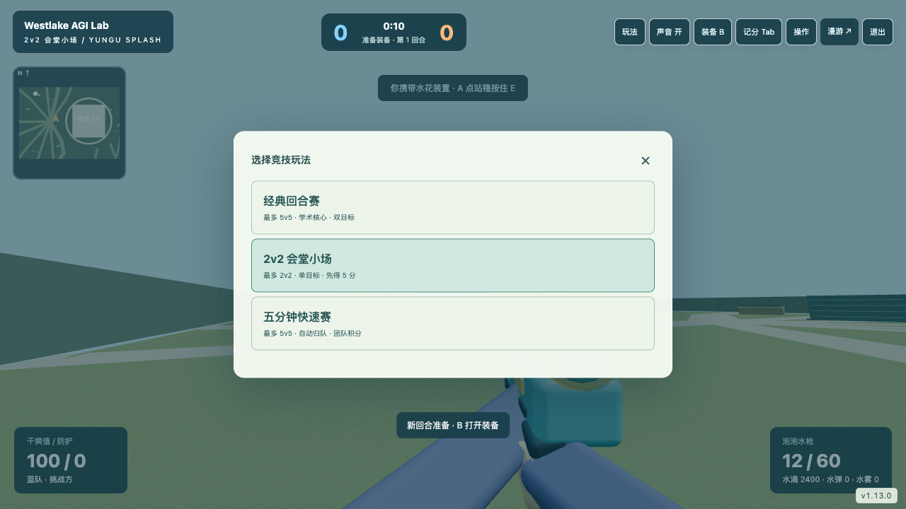

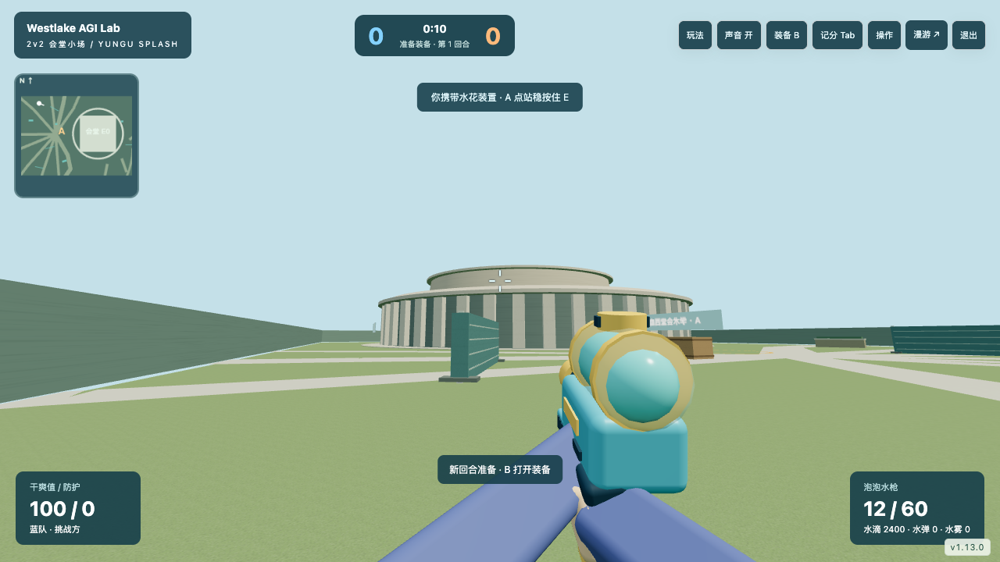

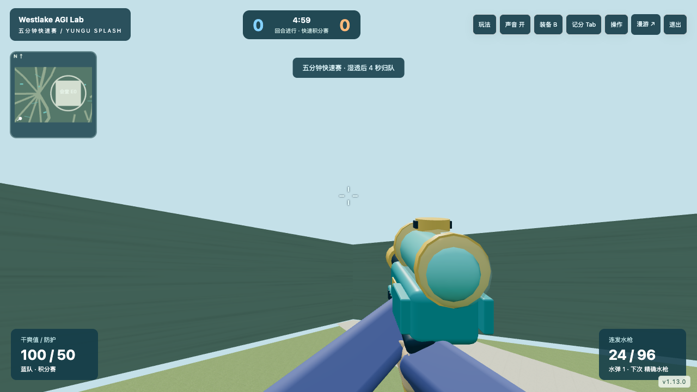

第一次玩时，先点击「进入视角」，用 WASD 移动、鼠标转头，把中央准星对准目标，按住左键呲水；按住右键精细瞄准。**R 是补水，相当于“换弹”**：右下角 `12 / 60` 的左边是当前水枪水量，右边是备用储水，按 R 后等待补水完成才能继续呲水；有备用储水时，没用完也可以提前补水。

| 常用操作 | 用途 |
| --- | --- |
| WASD / 鼠标 | 移动 / 转头瞄准 |
| 左键 / 右键 | 按住呲水 / 按住精细瞄准 |
| **R** | **补水（换弹）**，补水时不能呲水 |
| G / H | 投出携带的水弹 / 水雾球 |
| Q / F | 丢出当前水枪 / 拾取附近水枪，保留剩余水量 |
| Shift / Ctrl / 空格 | 按住慢走 / 按住蹲下 / 跳跃 |
| 按住 E | 在目标附近站稳启动或关闭装置，持续按住至进度完成 |
| B | 打开 / 关闭装备；回合赛准备或热身时选购，快速赛免费选下次入场装备 |
| 按住 Tab | 查看本场记分，松开关闭 |
| Esc | 释放鼠标、关闭面板；点击「进入视角」继续 |

经典回合赛先准备 15 秒，随后双方行动。挑战方携带装置去 A / B 点启动，守护方阻止或关闭装置；自己的「干爽值」降到 0 后，本回合观战，下一回合满状态归队。手机使用摇杆、拖动瞄准和动作按钮，「补水」按钮对应 R。完整的新手步骤、按键解释、不能移动或呲水的排查、回合规则和装备数值见 [水花竞技新手说明与开发](docs/water-mode.md)。游戏内「操作」保留按键速查。

v1.12.3 细化水枪与角色动作：三种玩具水枪有各自的轮廓、圆润外壳、透明储水罐、罐盖、枪口、握把与护圈。其他玩家会双手持枪，手臂随瞄准抬起，射击时回摆，补水时左手伸向罐盖、右手保持握枪；第一人称也显示双臂和对应装备，手部肤色沿用定制外观。水流从模型枪口喷出，落点有水滴溅射，水弹形成涟漪，命中角色呈淡蓝反馈。手机窄屏缩小并居中一些持枪模型。

以下为 v1.12.3 独立内存测试房间的实际画面；第三人称指观察另一个真实连接的玩家，自己的操作仍为第一人称。

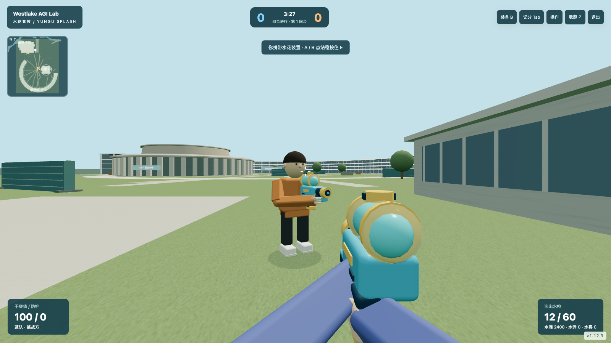

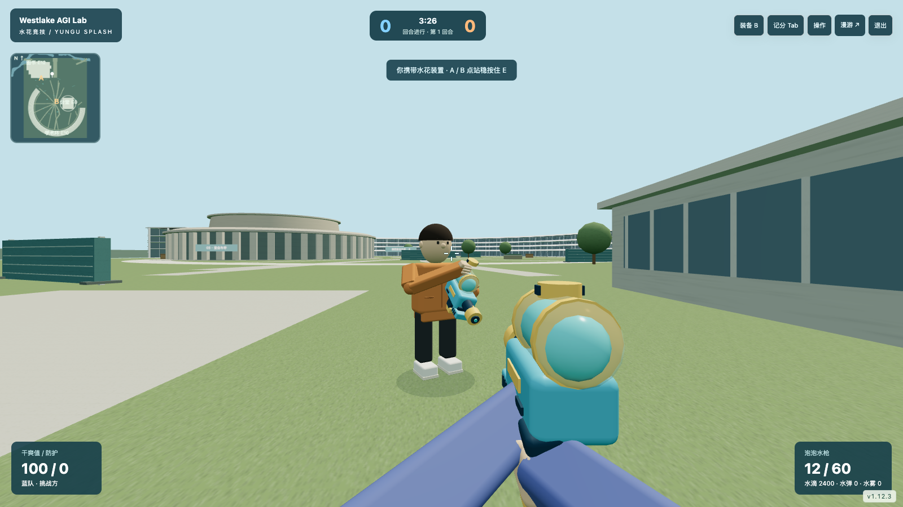

水枪静态部件按材质合并；特效最多复用桌面 256 / 触屏 160 个水滴、16 道短水流和 8 圈涟漪。动画读取既有射击和补水时间，不增加动画同步包；服务端继续负责命中判定。具体结构、性能取舍与测试方法见 [水花竞技开发说明](docs/water-mode.md)。v1.12.2 的新手说明与当前校园投掷边界修复继续保留。

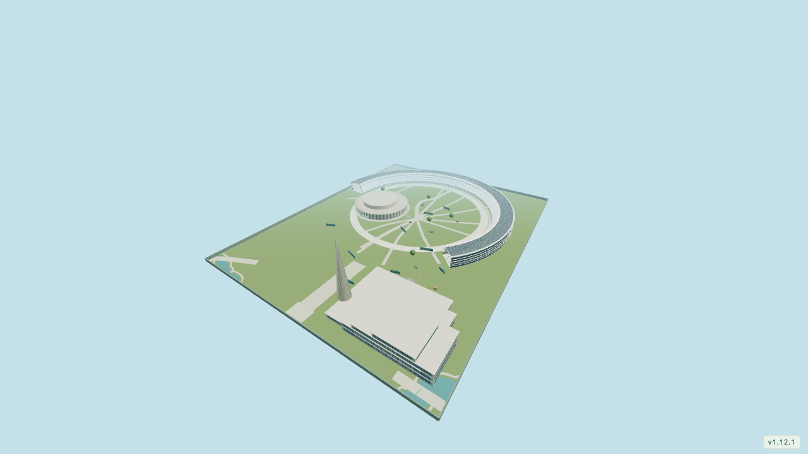

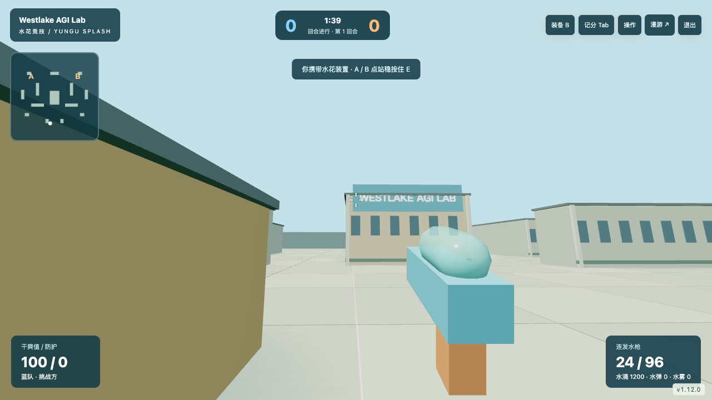

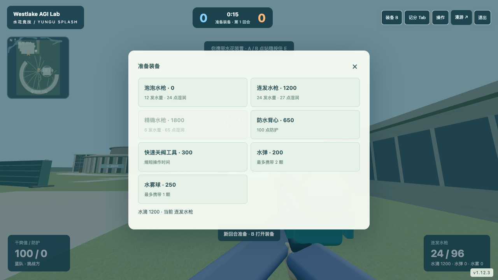

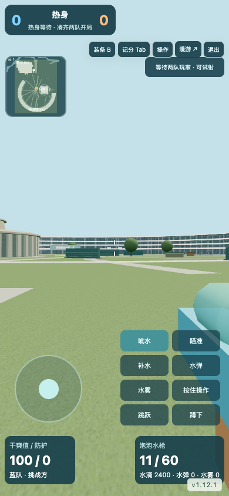

## 历史累计榜单

游戏顶部「榜单」打开「击倒榜 / 倒地榜」，查看所有账号从注册至今的累计记录，包含离线玩家；不是每日或每赛季的历史快照。只展示公开显示名字、击倒 / 倒地次数和名次，不展示登录用户名。相同次数并列（例如 1、1、3），同名账号分别统计；自己的行标记「你」，页外也能查看自己的名次。对应次数为零的账号暂不上该榜。

每页 20 人，可翻页、手动刷新；打开期间每 5 秒刷新，关闭后停止查询。按 Escape 或 × 关闭，查看期间角色停止移动、驾驶和对打。榜单不重置记录、不产生额外奖励。

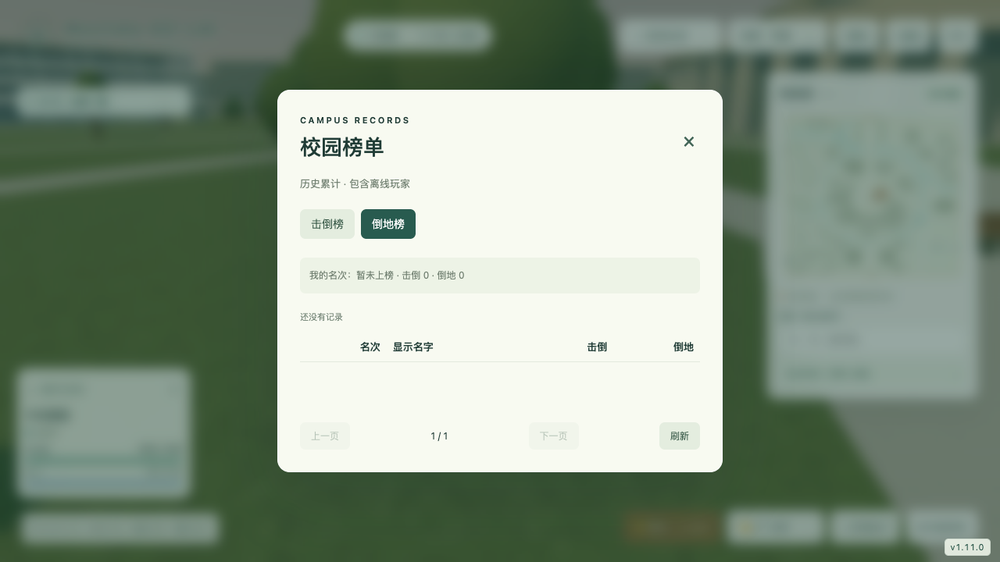

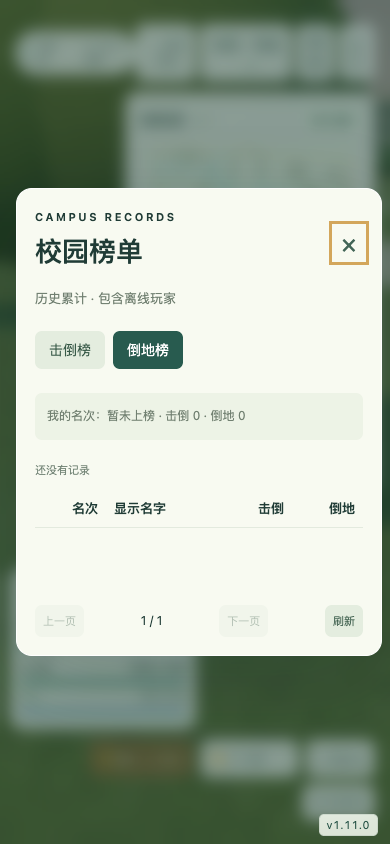

开发：`shared/leaderboard.ts` 定义公开数据；`AccountStore.leaderboard` 从现有 SQLite 记录计算并列名次及分页，`leaderboard` Socket 请求须登录并验证类型、页码和请求频率。只返回白名单字段，不读取密码、令牌、登录用户名；无需数据库迁移。击倒判定立即保存双方记录，离线和服务器重启后仍可查阅。测试用临时数据库验证排名、翻页、持久化及公开字段，不能修改正式存档来造榜单。

## 校园环线校车

两辆校车沿固定环线自动循环，连接 **南门 → 西南生活区 → 西北生活区 → 北门 → 东侧书院 → 体育区 → 南门**，每站停 12 秒，单车可乘 12 人。小地图显示橙色环线、站点和 `B1 / B2` 实时位置，搜索“校车站”可以导航或空降到站；车辆卡也能查看附近校车。

靠近校车按 **B** 或点“校车 B”上车，自动跟着车走；任何时候再按 **B** 即可在附近安全位置下车。校车会给行人和前方校车让行；遇到挡路的小车会先等待 0.75 秒，再逐步把车推向路肩，清障后继续；乘车时先暂停对打与空降，下车恢复。断线、刷新会释放座位并恢复为步行状态。汽车继续使用 R。线路是基于当前模型设计的游戏环线，详见 [乘坐规则、线路与开发说明](docs/shuttle.md)。

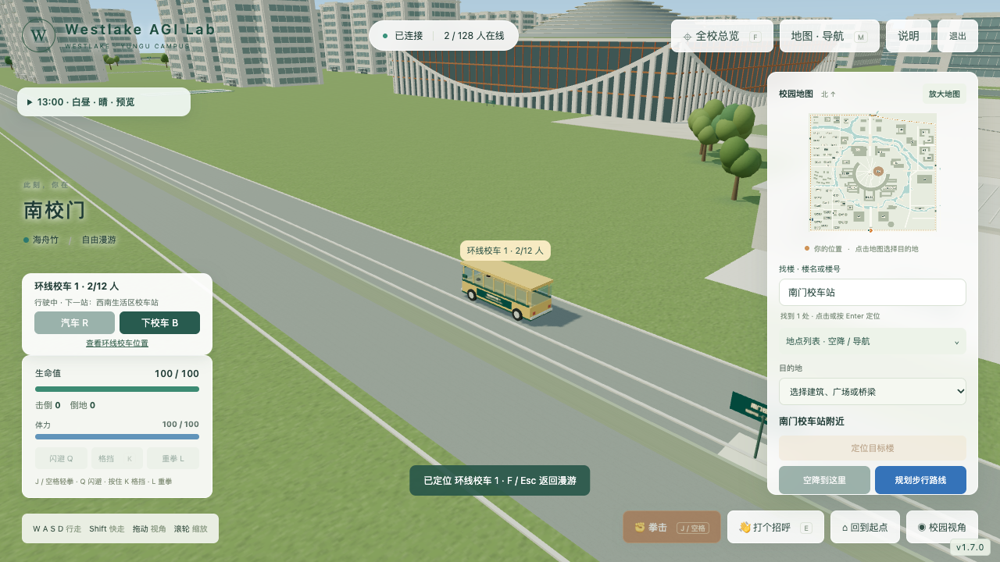

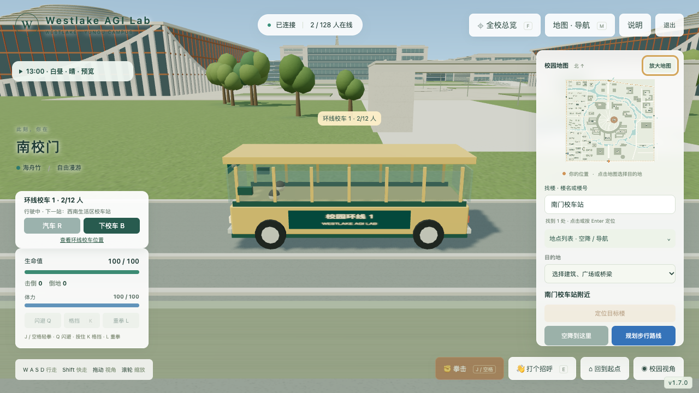

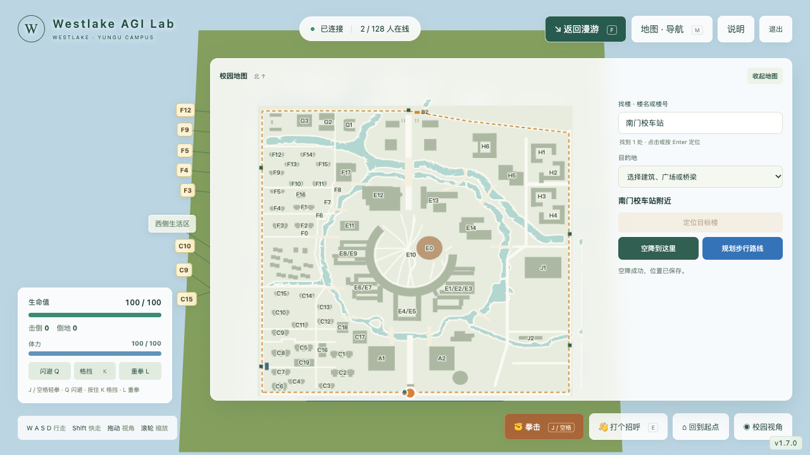

## 昼夜、天气与校园彩蛋

校园一天为现实 **24 分钟**，默认所有玩家按服务器时间共享昼夜；**每 6 分钟**在晴、多云和雨之间变化。左上角天气卡支持仅影响自己画面的时段与天气预览，夜间有星空、路灯和深夜亮窗。

搜索 **“深夜实验室”** 可导航或空降到工学楼 E1–E3 的彩蛋入口，校园 21:00–05:00 靠近会发现“实验还没跑完…”。搜索 **“校园猫”** 可找到庭园小径上的流浪猫；校园里共有四只不同毛色的猫，靠近点击“和校园猫打招呼”出现爱心。猫狗不会受伤；认领后的狗可以协助主人对打，规则见下方。天气卡提供猫、狗和深夜亮窗的定位入口。

周期、预览、互动规则与开发限制详见 [昼夜天气与校园彩蛋](docs/ambience.md)。所有新增场景素材由程序生成，天气不是实时气象，猫与亮窗是游戏创作。

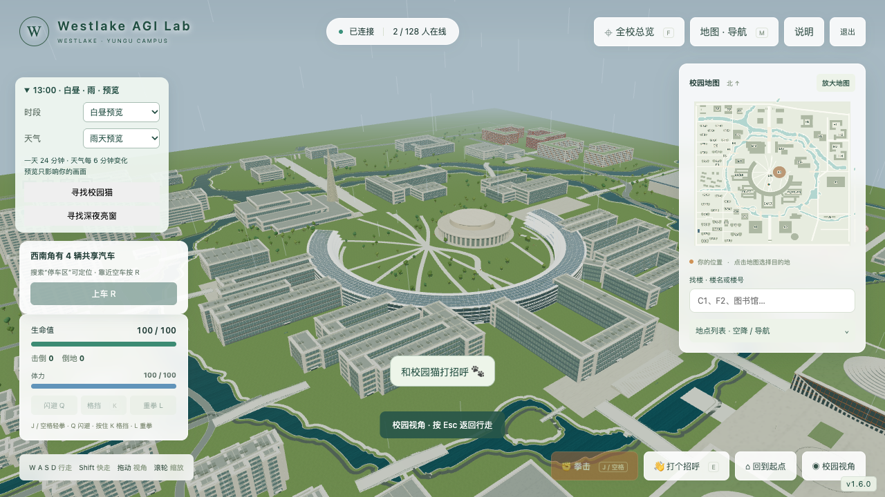

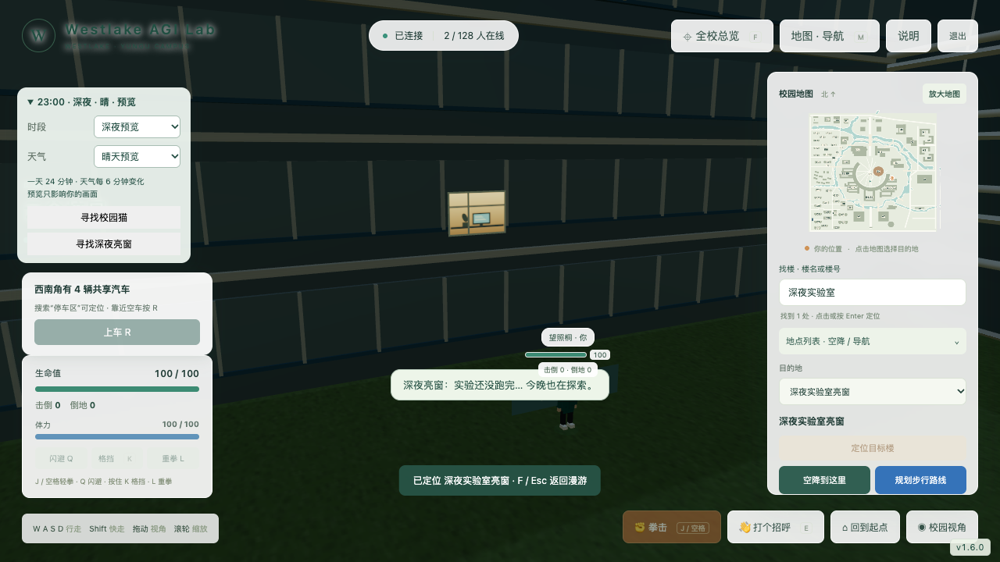

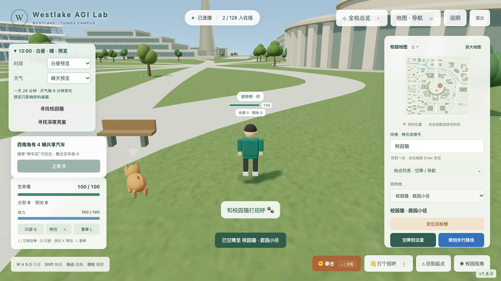

## 游戏画面

以下为游戏内实际截图，包含校园鸟瞰、全校总览和地标近景。截图采集于 2026 年 10 月 5 日；近景隐藏了操作面板，全校总览保留楼号、玩家位置与地图界面。

### 校园全景

**学术核心鸟瞰**：学术环、科研院落、中央庭园与水环之间的空间关系。

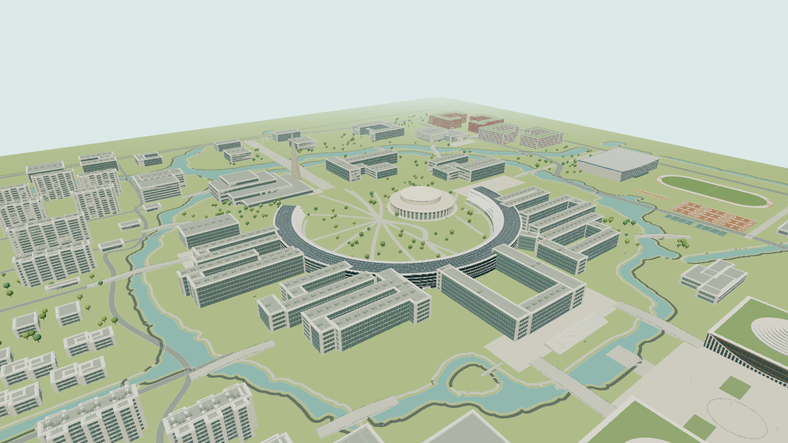

**全校总览**：拉远视角后查看生活区、学术区和运动区；建筑标签与“你在这里”帮助判断当前方位。

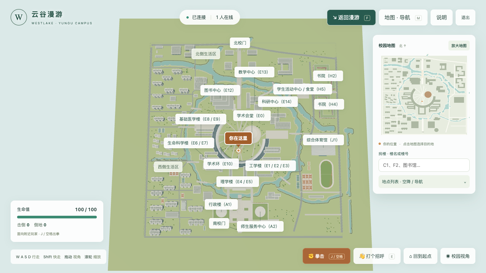

### 地标与建筑细节

| 学术环 · E10 | 学术会堂 · E0 |
| --- | --- |
| 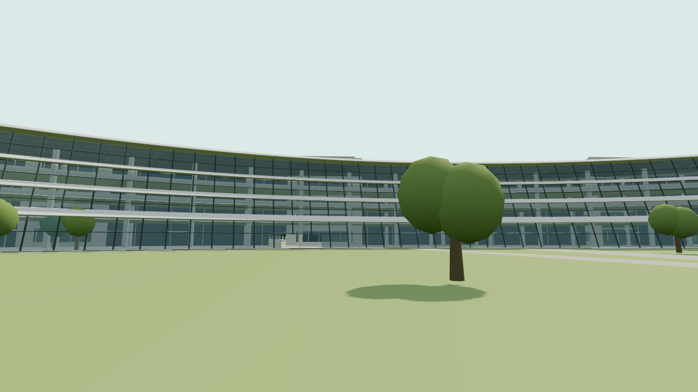 | 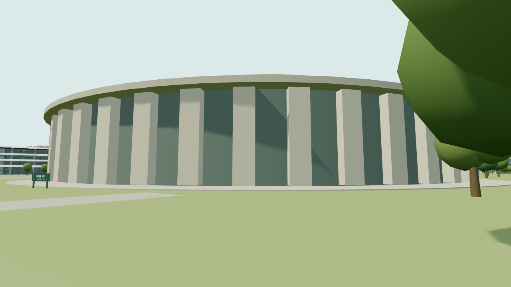 |
| 弧形幕墙与中央庭园一侧的近景。 | 中央庭园中的圆形会堂与立面柱列。 |

| 图书中心 · E12 | 行政楼 · A1 |
| --- | --- |
|  | 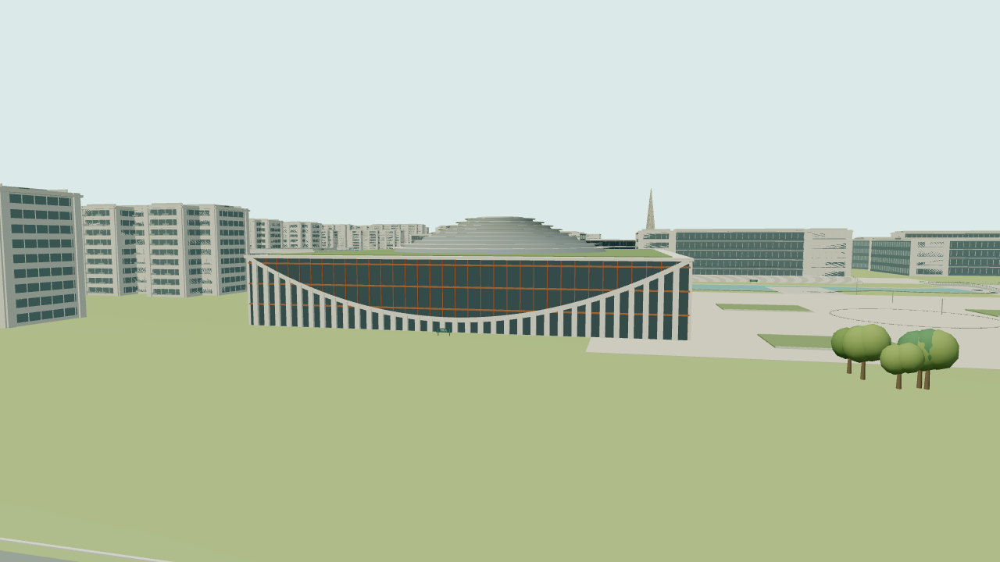 |
| 塔楼、竖向线条与入口立面的近景。 | 弧形立面、幕墙网格与南侧公共空间。 |

| 学生活动中心 / 食堂 · H5 | 综合体育馆 · J1 |
| --- | --- |
| 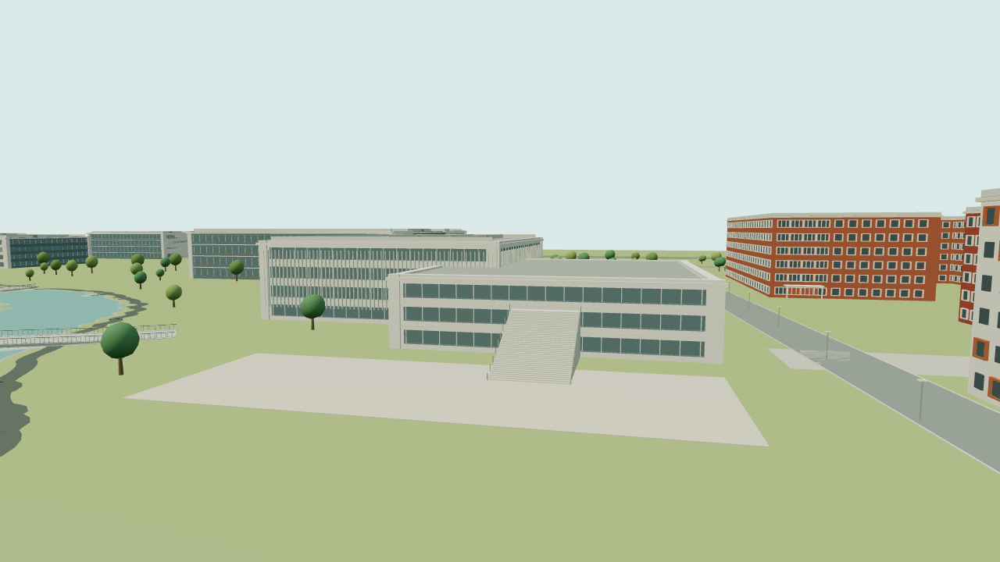 | 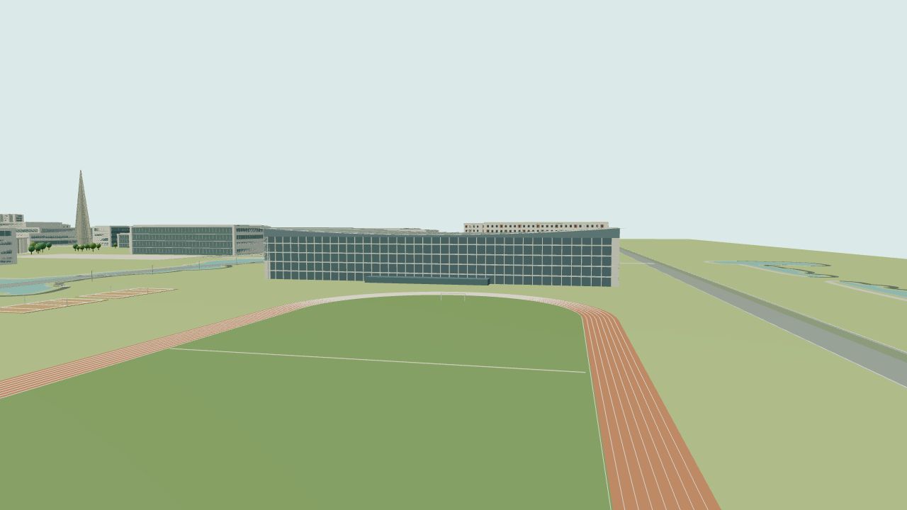 |
| 室外阶梯与周边书院、生活区建筑。 | 体育馆立面与田径场的场景关系。 |

| 南校门 | 水环与桥梁 |
| --- | --- |
| 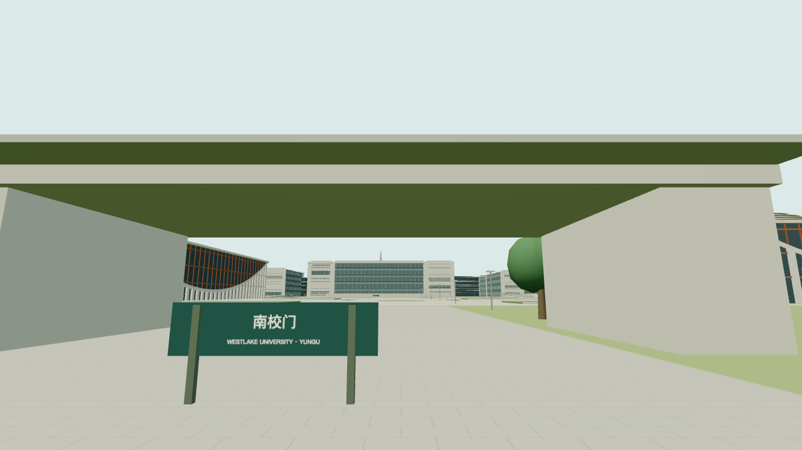 | 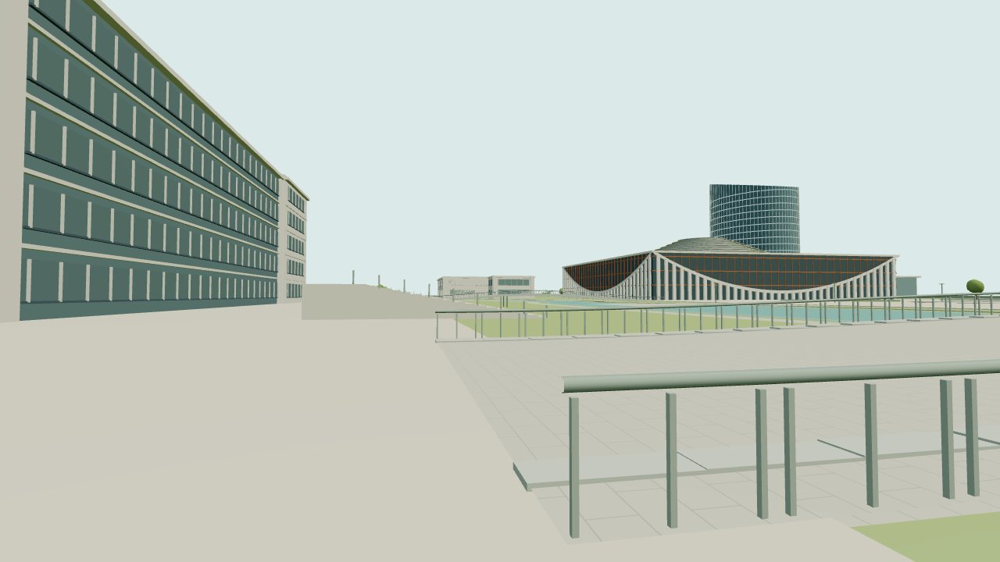 |
| 从校园入口望向内部建筑。 | 桥面、栏杆与连接两岸的步行通道。 |

图片保存在 [docs/images/](docs/images/)，使用仓库相对路径，可随源码在 GitHub 显示；截图来源与更新方式见 [截图说明](docs/images/README.md)。

## 快速开始

### 运行要求

| 项目 | 要求 |
| --- | --- |
| Node.js | `>= 22.13.0`；已验证 Node.js 24.x。项目使用内置 `node:sqlite` |
| npm | 随 Node.js 安装；使用仓库的 `package-lock.json` 执行 `npm ci` |
| 浏览器 | 支持 WebGL 的桌面浏览器；浏览器自动化测试使用 Google Chrome |
| Python | 普通安装和试玩无需 Python；重新生成总平面或使用源码同步工具需要 Python 3 |
| Git / SSH | 普通试玩无需 SSH；三方源码合并和远程维护需要 Git、SSH |

以下命令均在**含有 `package.json` 的项目根目录**执行。获取源码后进入 `westlake-campus-game` 目录；如果克隆后的仓库根目录已包含 `package.json`，无需再进入同名子目录。

```bash
git clone https://github.com/Westlake-AGI-Lab/westlake-campus-game.git
cd westlake-campus-game
npm ci
npm run build
npm start
```

打开 [http://127.0.0.1:3000](http://127.0.0.1:3000)，点击“首次注册”，填写自己的登录用户名，从三组候选字中组合公开显示名字，设置密码，并定制肤色、发型、发色、服装、外套颜色、裤装和配饰。三维预览实时显示搭配；之后使用同一用户名和密码登录，恢复已保存的外观。

`npm start` 在当前终端前台运行。按 `Ctrl+C` 正常关闭服务。macOS 也可以双击 [启动校园.command](启动校园.command)，它会在终端检查依赖、构建和启动；不会安装后台服务。

### 开发模式

```bash
npm ci
npm run dev
```

打开 [http://127.0.0.1:5173](http://127.0.0.1:5173)。开发命令同时启动 Node.js 后端和 Vite 前端；Vite 将 `/socket.io` 和 `/health` 代理到后端。

前端支持热更新。**后端、后端读取的共享代码或数据修改后，需要停止并重新运行 `npm run dev`**，当前脚本没有后端自动重启功能。开发时使用 Vite 地址；直接访问后端 `:3000` 只会提供已构建的 `dist`，可能看不到最新前端改动。

正式运行时只需一个 Node.js 进程，同源提供两个游戏的网页、静态资源和 WebSocket；三个固定竞技房间分别使用 `/water`、`/water-duo`、`/water-quick` 命名空间。`/health` 的 `waterOnline` 是竞技总人数，`waterRooms` 提供各玩法人数。源码变化后应重新构建并重启服务，单独刷新浏览器不会更新运行中的后端。

## 玩家使用规则

### 账号、名称和存档

1. **登录用户名**：自己指定，3–32 个字符，支持字母、汉字、数字和 `_ . -`。规范化全角字符、去除首尾空白，英文字母不区分大小写；内部空格和隐藏字符不接受。用户名只用于登录，不向其他玩家公开。
2. **显示名字**：三组候选字各选一个字，组成公开的三字名字；可点击换名按钮。它显示在角色头顶和游戏界面，允许与其他玩家重复，但不能与自己的登录用户名相同。不同账号用稳定 ID 区分，存档互不影响。
3. **公开名字过滤**：前后端共用 [data/name-policy.json](data/name-policy.json)，校验候选字并拒绝屏蔽词组合。该选字策略用于显示名字，私有用户名另用 [shared/usernames.ts](shared/usernames.ts) 的格式规则。
4. **用户名唯一**：规范化后的登录用户名不能重复注册，包括同时提交的重复注册。请记住用户名与密码；显示名字不能替代用户名登录。
5. **密码**：长度为 6–128 个字符。服务端保存随机盐和 scrypt 密码哈希，浏览器不保存密码。当前没有密码找回功能。
6. **在线规则**：一个账号同一时间只能在一个页面在线，房间最多 128 人。多页联机测试请使用不同账号；切换设备前先退出原页面的账号。
7. **恢复规则**：刷新或短暂断网可以自动恢复会话。浏览器使用 `sessionStorage` 保存自己的令牌、登录用户名、显示名字和外套颜色；关闭标签页后重新打开通常需要再次登录。令牌有效期为 24 小时，使用用户名和密码重新登录会换发令牌。

角色外观和以下游戏记录会长期保存：

| 内容 | 保存方式 |
| --- | --- |
| 角色外观 | 注册时保存七项选择；重新登录、换设备和重启后恢复 |
| 位置 `x / z` | 在线约每秒保存；正常退出、断线、回到起点和空降时立即保存 |
| 击倒数 | 成功使其他玩家血量归零时增加；与对方倒地数在同一事务中保存 |
| 倒地数 | 自己血量归零时增加，与击倒数一起保留到下次登录 |

账号 ID、私有用户名、公开显示名字、密码哈希和会话令牌哈希属于必要账号信息。**血量、体力、临时动作、朝向、聊天和复活保护不作为长期游戏存档保存**。

同一服务器进程内，30 秒内的短暂断线恢复会保留当前血量。退出后重新登录、恢复窗口结束后重新进入或服务器重启后，以满血进入，并恢复已保存的位置和记录。若模型更新后存档位置落在障碍中，服务器会选择安全出生点，原记录保留。

正常停止服务会先保存在线玩家再退出。强制终止或机器故障可能丢失最后一次保存之后的位置变化。账号属于所连接服务器的数据库：本机和远程服务器是不同的存档环境，源码同步不会自动合并玩家账号。实现和用例见 [账号说明](docs/accounts.md)。

旧账号仍用原三字用户名和密码登录，ID、位置、记录和令牌保留。升级会分配另一个合法的公开显示名字，避免在头顶暴露原登录名；此后显示名字保留。旧浏览器会话自动兼容。详细迁移与回退规则见 [账号说明](docs/accounts.md#旧账号升级)。

### 操作

| 操作 | 按键或入口 |
| --- | --- |
| 行走 | `WASD` 或方向键 |
| 快走 | 按住 `Shift`，速度 12 米/秒 |
| 转动视角 | 按住鼠标左键或右键拖动 |
| 拉近 / 拉远 | 鼠标滚轮；可以拉远到看到全校 |
| 全校总览 / 返回原视角 | `F` 或“全校总览”按钮 |
| 地图与导航 | `M` 或“地图 · 导航”按钮 |
| 附近交流 | `E` |
| 靠近空车上车 / 驾驶时下车 | `R` |
| 靠近校车上车 / 随时下校车 | `B` 或车辆面板按钮 |
| 拳击 | `J`、空格或“拳击”按钮 |
| 关闭面板 / 退出固定视角 | `Esc` |
| 回到中央庭园 | “回到起点”按钮 |
| 浏览预设相机 | “校园视角”菜单 |
| 退出账号 | 页面中的“退出”按钮 |

账号输入、面板操作、窗口失焦、切换到后台或断线时会停止角色移动。固定相机用于观察校园，不会自动把角色移动到镜头位置。“回到起点”只改变位置，不恢复血量，也不清空记录。

### 楼宇搜索、空降和导航

**搜索楼宇**：在地图“找楼”输入楼名、楼号或别名，例如 `C1`、`F2`、`图书馆`。结果同时显示名称与楼号；点击结果或按 `Enter` 会定位镜头并高亮建筑，角色位置不变。可以用 `F`、`Esc` 或“返回漫游”回到角色。

搜索支持大小写、全角字符和空白规范化。完整楼号按精确代码匹配，`C1` 不会被当成 `C10`；`C` 和 `F` 系列分别识别。不确定的楼号不补造，正式名称及依据见 [楼宇目录](docs/building-directory.md)。

**选择目的地**：点击地图任意位置，或展开“地点列表 · 空降 / 导航”，选择建筑、广场、桥梁或栈道。放大地图后可以查看校园整体位置和目标附近的建筑。

**空降**：点击“空降到这里”，服务器检查坐标并寻找安全落点。建筑、水面或其他玩家占据的位置可能调整到附近可站立处；桥面允许落点。地图外围的点击限制在校园范围内，连续空降间隔为 1.5 秒。

空降会立即同步并保存新位置，**不改变血量、击倒数、倒地数或复活保护**，不会因空降增加倒地数，也不能用它回血。

**步行导航**：点击“规划步行路线”，三维场景与地图同时显示蓝色路线、目标标记和剩余距离。玩家沿路线自行行走。建筑目标设在附近的可通行位置，不表示可以进入楼内。

路线避开建筑、水面和校园边界，可经过桥面、栈道和开放草地。移动超过约 5 米、偏离路线、回到起点、空降或复活后会重新规划；距终点 3 米以内提示到达并结束。路线卡片的 `×` 可以取消导航，重新选择地点可以替换目标。封闭区域可能无法规划，遇到提示时可选择入口附近的地点。详见 [地图空降与导航](docs/navigation.md)。

### 拳击、血量与复活

| 规则 | 当前值 |
| --- | --- |
| 满血 | 100 |
| 单次有效拳击伤害 | 25 |
| 两次出拳的最小间隔 | 600 毫秒 |
| 有效距离 | 2.4 米以内 |
| 正面范围 | 朝向左右各 75° |
| 复活保护 | 2 秒；主动出拳会提前结束自己的保护 |
| 自动回血 | 连续 5 秒无出拳、受伤后，每秒 2 点 |
| 角色尺寸 | 每击倒 +6%，每倒地 −6%，范围 70%–160% |

攻击由服务器判定：目标必须在范围内，且不能隔着墙体、水面等障碍命中；桥面、高度和通行关系也参与判断。满血且没有保护、未格挡或闪避的目标受到四次普通有效命中后倒地。

血量归零后，服务器在校园内选择安全位置满血复活，保留累计记录。玩家头顶显示血槽、“击倒”和“倒地”两个数字，自己的状态也显示在界面中。界面和公开说明统一使用这两个称呼；内部存档仍保留 `kills / deaths` 字段名以维持兼容。

拳击是游戏互动，请尊重其他玩家，不利用客户端修改、脚本刷记录或重复干扰他人的漫游。开发者修改规则时应同时更新前后端提示和 [拳击规则](docs/combat.md)。

### 对线操作与克制

- **J / 空格 / 拳击按钮**：轻拳，25 伤害、消耗 8 体力，600 毫秒间隔。
- **按住 K**：正面 120° 格挡。屏幕“格挡”按钮点击开启或关闭；移动会减速。轻拳仅造成 5 伤害，背后攻击仍造成完整伤害。
- **精准招架**：格挡开始后的 180 毫秒内挡住轻拳，可免伤并让对方硬直 450 毫秒。重新开启格挡至少间隔 600 毫秒，并消耗体力，不能连续无代价刷新招架窗口。
- **L / 重拳按钮**：消耗 35 体力，前摇 650 毫秒后按当时的真实位置判定，完整伤害 40，出拳间隔 1.4 秒。正面命中格挡造成 25 伤害并破防、硬直 450 毫秒。蓄力时减速，头顶提示和橙色光圈给对手躲避机会。
- **Q / 闪避按钮**：消耗 25 体力，沿当前移动方向冲刺；没有方向输入时向前。闪避持续 250 毫秒，期间避开拳击，冷却 1.2 秒；仍受建筑、水面和边界阻挡。

体力上限 100，格挡开启消耗 6，持续每秒消耗 18；普通格挡受到一拳再消耗 10，重拳破防再消耗 20。停止战斗消耗 0.8 秒后每秒恢复 16。攻击、蓄力、闪避、硬直存在动作限制；轻拳与重拳共用出拳冷却。体力条、技能按钮、头顶状态与角色姿势帮助观察双方节奏。失焦、切换标签页、打开菜单或松开 K 会解除格挡，服务器也会让未续期的格挡在 300 毫秒后结束。

先用轻拳试探，观察对手格挡后用重拳破防；看到橙色蓄力提示可方向闪避，再抓住恢复时间反击。尺寸仍只影响外观，拳击距离和碰撞半径一致。这里仍是校园多人自由互动，没有排名、配对或专用决斗房间。

新动作不改变账号存档字段：体力和临时动作不长期保存，断线恢复保留当前体力和冷却并取消未完成的蓄力、闪避、格挡；重新登录和复活恢复体力。重拳、闪避或硬直期间暂不能空降或回起点。协议只接受动作、方向和序号，不接受伤害、目标或体力等客户端数值。

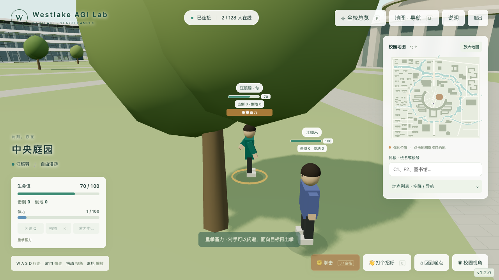

*隔离测试房间真实 Chrome 截图（2026-10-05），包含一个浏览器玩家和一个独立真实协议连接玩家。*

### 尺寸变化与自动回血

击倒别人后角色尺寸增大 6%，倒地后缩小 6%。尺寸按 `1 + (击倒数 - 倒地数) × 0.06` 计算，限制在原始尺寸的 70%–160%，随账号战绩保留。角色、保护效果和头顶标签跟随尺寸变化；行走速度、碰撞半径和拳击距离保持一致。

连续 5 秒没有出拳或受到伤害后，每秒恢复 2 点生命，最多 100 点。出拳（含未命中）或受伤重新计时；走路、空降不打断回血。回血由服务器统一判定并同步所有玩家。断线期间不累计回血；正常复活仍立即满血，血量不额外存档。参数见 `shared/config.ts`，尺寸公式见 `shared/player-size.ts`。

### 共享汽车

v1.5.0 在西南角新增游戏内停车区和 4 辆共享汽车。地图搜索“停车区”即可定位、导航或空降。靠近空车按 **R 上车**，**W/S 前进或倒车、A/D 转向、空格刹车、R 停车并下车**；也可点击车辆面板按钮。下车后车留在原地，其他玩家可以继续使用，每辆车一次只能一人驾驶。

车辆有加速、减速和转向，最高前进 54 km/h、倒车 18 km/h。建筑、水域、校园边界、车辆和行人会阻挡车辆，开车不会造成撞人伤害。车内不能参与对打、空降或回起点，先下车再操作。步行导航不提供自动驾驶，遇到停放车辆需要绕行。

失焦或输入超时自动刹车；退出、刷新、断线会停车并释放驾驶位。汽车位置在当前房间内共享，后加入者也能看到原地停放的车。服务器重启后车回到停车区；玩家存档继续保留。v1.13.2 改用真实旋转车身碰撞，消除离车身仍有空隙却无法驾驶的情况；已经接触车辆时允许朝脱离方向移动。校车清障保留驾驶位，司机随车同步，可继续驾驶；狭窄位置无法推开时，阻挡持续 6 秒后会选择检查过的附近安全位置挪车，停车区空位作为最后候选。停车区为游戏新增设施，详细规则、协议及维护方法见 [共享汽车说明](docs/vehicles.md)。

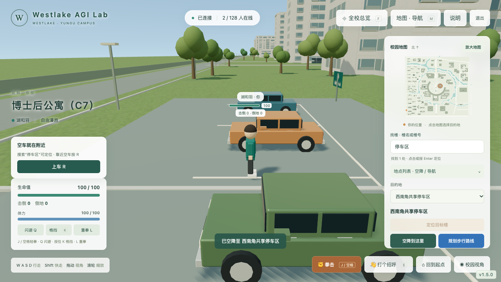

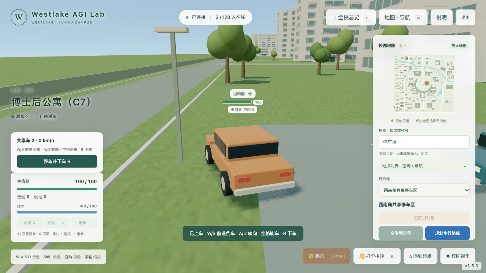

### 校园楼号标注

v1.4.1 对照用户提供的校园地图补齐全校总览中的生活区楼号：C1–C19、F 区以及其他已确认有代号的楼宇显示紧凑标牌。主要地标保留“楼名＋代号”，新增紧凑标牌悬停可查看楼名；小地图也在建筑轮廓上显示代号，可放大查看。所有标注读取同一份楼宇目录，搜索、定位、导航和空降继续使用一致的楼号。

参考图中没有明确代号的建筑不自行编造楼号。密集区域使用避让和引线，窗口较小时部分标牌可能隐藏，可通过放大地图或输入楼号准确定位。楼号核对与维护见 [楼宇目录说明](docs/building-directory.md)。

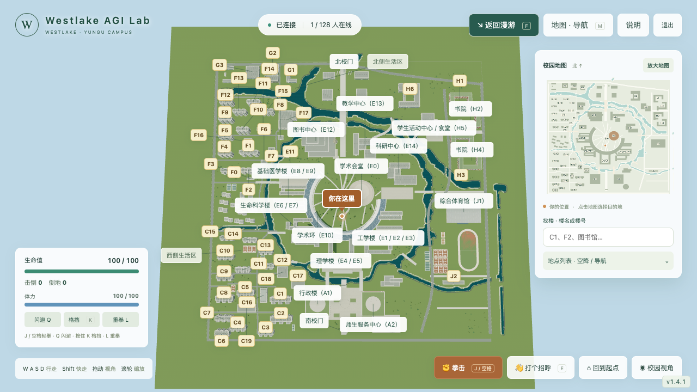

### 三维画面与风格

v1.4.0 将校园画面统一为明亮、温暖的风格化 3D：玻璃环境反光、石材与草地细节、缓慢水纹、分簇树冠与贴地阴影；建筑入口补充雨棚与门框。人物使用圆角轮廓和平滑头部，增加五官、衣服缝线、鞋底和鞋带，注册预览与游戏内模型一致。

画面资源由本项目程序生成，建筑位置、导航、碰撞与对战规则保持一致。采用实例绘制和共享材质，避免给所有建筑构件增加高面数倒角；没有实时水面镜像或全屏后处理。当前是风格化浏览器游戏，后续仍可逐步加入更细致的建筑和人物资产。实现、性能取舍及截图验证方法见 [画面开发规则](docs/art-direction.md)。


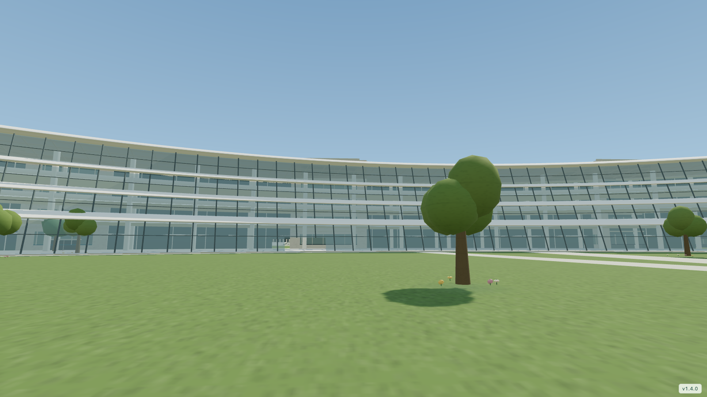

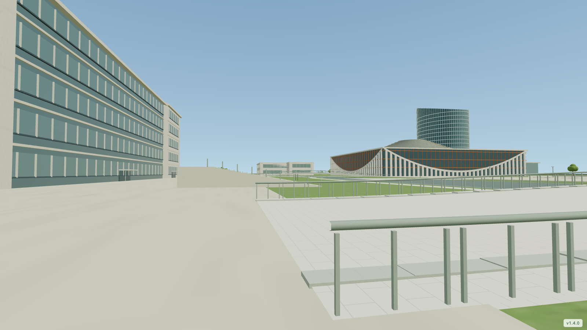

### 注册角色定制

注册页面提供实时三维预览和随机搭配，预览与校园内角色使用同一套模型。

| 选项 | 可选内容 |
| --- | --- |
| 肤色 | 5 种 |
| 发型 | 短发、侧分、卷发、中长发、丸子头 |
| 发色 | 6 种 |
| 服装 | 经典外套、连帽衫、棒球夹克、衬衫 |
| 外套颜色 | 6 种 |
| 裤装 | 5 种颜色 |
| 配饰 | 无、圆框眼镜、帽子、围巾、背包 |

外观随账号保存并同步给其他玩家；所有搭配具有相同的移动、碰撞和对战规则。登录页面直接恢复存档，目前不提供注册后的外观编辑。旧账号保留经典造型，首次成功认证进入时按原浏览器会话的外套颜色初始化；此前版本没有长期保存外套颜色，无法追溯已丢失的颜色。

开发时维护 [shared/appearance.ts](shared/appearance.ts) 的固定选项，服务器严格验证七项整数，拒绝额外字段。数据库版本 3 新增可空的外观字段，迁移保留原账号、密码、令牌、位置和记录。编号不得重排，详见 [外观开发说明](docs/appearance.md) 和 [账号迁移规则](docs/accounts.md)。

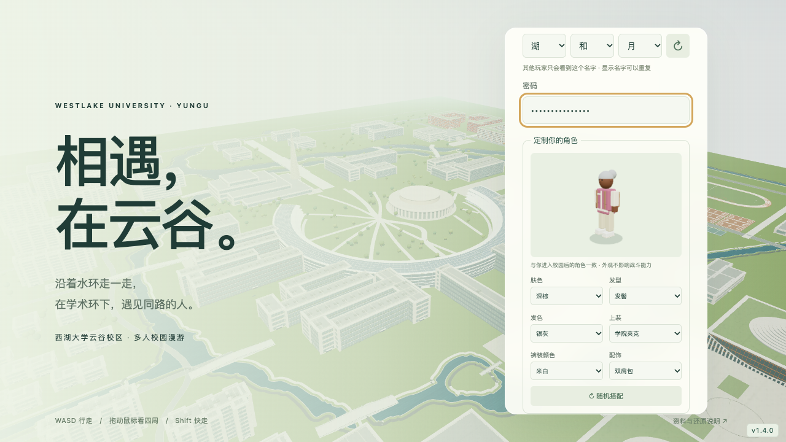

### 交流

附近交流只允许选择内置短语或表情，没有自由输入聊天。消息在 40 米内显示约 3 秒，发送间隔至少 1 秒。消息不进入账号存档。新增短语时在 [shared/config.ts](shared/config.ts) 的 `MESSAGES` 中维护，并由服务器验证消息 ID，不能直接接受任意客户端文本。

## 运行配置

需要调整配置时复制模板：

```bash
cp .env.example .env
```

开发和正式启动都读取 `.env`。环境变量也可在启动命令中指定；`.env` 不提交到 Git。

| 变量 | 默认值 | 用途 |
| --- | --- | --- |
| `HOST` | `127.0.0.1` | Node.js 监听地址；仅需其他设备访问时设为 `0.0.0.0` |
| `PORT` | `3000` | Node.js 服务端口 |
| `DEV_PORT` | `5173` | Vite 开发端口 |
| `ACCOUNT_DB` | `var/accounts.sqlite` | SQLite 存档；相对路径以启动工作目录为基准，也可使用绝对路径 |

macOS / Linux 示例：

```bash
PORT=3100 npm start
PORT=3100 DEV_PORT=5174 npm run dev
HOST=0.0.0.0 PORT=3000 npm start
```

Windows PowerShell 可先设置 `$env:PORT = "3100"`，再执行 `npm start`。局域网玩家使用服务器机器的局域网地址和端口，不能使用自己机器的 `127.0.0.1`。端口冲突时关闭旧服务或更换端口。

测试环境可使用 `ACCOUNT_DB=:memory:`；该数据库在进程退出后丢失。正式环境应使用持久化文件。`GET /health` 返回服务状态和在线人数，可用于启动检查，但不能代替账号、联机和存档验证。

房间、速度、输入超时、交流和拳击参数在 [shared/config.ts](shared/config.ts) 中维护。默认模拟步长 50 毫秒（20 Hz），快照间隔 100 毫秒（10 Hz），行走 / 快走速度分别为 4.6 / 12 米每秒。更改这些参数需要复核客户端预测、服务器限制和相关用例。

## 项目结构与架构

| 路径 | 职责 |
| --- | --- |
| [client/main.ts](client/main.ts) | 页面入口、交互、网络连接与主循环 |
| [client/accounts.ts](client/accounts.ts) | 注册、登录、候选字与浏览器会话 |
| [client/scene.ts](client/scene.ts)、[client/academic-loop.ts](client/academic-loop.ts) | 参数化场景与学术环模型 |
| [client/landmarks.ts](client/landmarks.ts)、[client/landscape.ts](client/landscape.ts)、[client/avatars.ts](client/avatars.ts) | 地标、景观与玩家模型 |
| [client/overview.ts](client/overview.ts) | 校园总览与相机 |
| [client/navigation.ts](client/navigation.ts)、[client/navigation.worker.ts](client/navigation.worker.ts) | 地图、路线显示与浏览器规划 Worker |
| [server/index.ts](server/index.ts) | HTTP、静态资源、Socket.IO 与服务生命周期 |
| [server/game.ts](server/game.ts)、[server/combat.ts](server/combat.ts) | 房间、权威移动、断线恢复、攻击与复活 |
| [server/accounts.ts](server/accounts.ts) | 账号校验、密码哈希、SQLite 与存档 |
| [shared/vehicles.ts](shared/vehicles.ts)、[client/vehicles.ts](client/vehicles.ts) | 共享车辆规则、碰撞、动力学、车辆模型和停车区 |
| [shared/shuttle.ts](shared/shuttle.ts)、[client/shuttle.ts](client/shuttle.ts) | 固定环线、站点、自动运行、多人乘坐与校车模型 |
| [client/art.ts](client/art.ts) | 自制表面纹理、天空和预过滤环境反射 |
| [shared/appearance.ts](shared/appearance.ts)、[client/appearance.ts](client/appearance.ts) | 外观选项、严格校验与注册三维预览 |
| [shared/types.ts](shared/types.ts)、[shared/config.ts](shared/config.ts) | 协议类型与共用规则 |
| [shared/world.ts](shared/world.ts) | 碰撞、地面高度、桥梁与安全落点 |
| [shared/buildings.ts](shared/buildings.ts)、[shared/destinations.ts](shared/destinations.ts) | 楼宇名称、代码、搜索与目的地 |
| [shared/navigation.ts](shared/navigation.ts)、[shared/navigation-geometry.ts](shared/navigation-geometry.ts) | 网格规划和可通行几何 |
| [data/campus.json](data/campus.json) | 渲染、物理、小地图和验证视角的共同场景数据 |
| [data/building-directory.json](data/building-directory.json) | 楼名、楼号、别名、资料依据和部分定位修正 |
| [data/name-policy.json](data/name-policy.json) | 公开显示名字的候选字与屏蔽词 |
| [shared/usernames.ts](shared/usernames.ts) | 私有登录用户名的格式和规范化 |
| [scripts/migrate-accounts.ts](scripts/migrate-accounts.ts) | 显式迁移并核对原账号认证 / 游戏字段保留 |
| [data/navigation.json](data/navigation.json) | 根据场景生成的导航缓存 |
| [assets-src/](assets-src/) | 可编辑的布局、描图参数与数据生成脚本 |
| [tests/](tests/)、[scripts/](scripts/) | 自动测试、审计、报告与维护工具 |
| [docs/](docs/) | 规则、资料、重建说明和限制 |
| [deployment/](deployment/) | 现有维护环境的服务模板及发布记录 |
| `reports/`（本机生成，不提交） | 检查结果、对照图和验收页面 |
| [references/manifest.json](references/manifest.json) | 参考资料目录、来源与用途 |

### 数据流

浏览器发送移动意图，服务器通过共享物理规则推进真实状态，再广播快照。客户端使用预测和插值改善显示，服务器的位置和记录是最终依据。拳击、空降、注册和存档同样由服务器校验，不能通过只改浏览器状态来改变其他玩家的数据。

`data/campus.json` 同时用于建筑绘制、碰撞、地图、目的地和验证相机。坐标以米为单位，`+X` 为东、`-Z` 为北、`Y` 为高度；这个比例来自参考资料和估算，并非已核实的竣工测量值。

导航使用 2 米步长的八方向网格，浏览器 Worker 运行 A*；网格边和简化后的路线都检查障碍。`npm run build` 根据校园数据和共享碰撞代码的内容哈希更新 `data/navigation.json`，不要手工修改缓存来修复路线。

账号使用 SQLite WAL，普通位置保存与关键事件保存分别处理。服务器正常退出时保存玩家并关闭数据库。游戏状态仍属于单个 Node.js 进程；目前没有用于多实例共享房间状态的适配器。

### 协议入口

协议类型以 [shared/types.ts](shared/types.ts) 为准，事件注册和限制以服务器代码为准。新增交互需要定义输入、成功响应、失败响应以及状态同步方式，不能只新增客户端按钮。

需要保留服务端的输入类型、有限数字、序列号、范围和频率校验。当前配置限制移动输入为每秒 45 次，Socket.IO 消息大小上限为 4096 字节；注册 / 登录共用每个来源 IP 每分钟 256 次的限制。客户端反馈必须能解释拒绝、断线和失效会话，错误路径也应有相应验证。

## 开发约定

以下是公开项目的贡献约定。维护者本地的 `AGENTS.md` 不随仓库提交；Fork 可自行补充协作规则，远程部署按自己的环境配置。

### 代码与共享规则

1. 使用 TypeScript 和现有 ESM 模块方式；通过 `npm run build` 的类型检查。保持依赖锁文件一致，不因开发环境差异随意重写整个锁文件。
2. 移动、碰撞、安全落点和导航几何尽量复用 `shared/`。不要在客户端和服务器分别维护含义相同但数值不同的规则。
3. 服务端决定账号身份、伤害、复活、计数和持久化。不要信任客户端上报的血量、记录或未经校验的目标坐标。公开 `Player.name` 只取显示名字，不直接广播 `Account`；登录用户名和令牌只通过本人连接的私有确认返回。
4. 修改协议时同步维护类型、发送端、接收端、失败提示和真实 Socket.IO 用例。处理重连、重复请求、非法输入和未登录请求。
5. 更改数据库结构或存档含义前设计明确的迁移和回退步骤。当前有旧单名称账号到版本 2，以及外观字段到版本 3 的事务迁移和核对工具；进一步的结构变化仍需显式迁移，不可只依赖建表语句或删除玩家数据库。
6. 维护可追溯的修改：将行为相关的逻辑放在对应模块，避免无关重构和大范围格式化混入同一个功能提交。

### 场景、性能和界面

- 保持校园模型由可编辑参数生成；使用可重复的随机种子。新增运行资产应能随项目分发，不依赖开发者个人目录或临时下载网址。
- 修改通道、楼体、桥梁、水系和台阶时，同时检查渲染、碰撞、高度、小地图和导航。看起来能走的位置应与服务器判定一致。
- 控制几何数量、材质数量和每帧分配；批量重复物体优先复用几何或实例。移除三维对象时清理不再使用的几何、材质、纹理和监听器。
- 用户界面保持中文名称和楼号可读，继续支持键盘、鼠标、总览与普通漫游之间的返回；输入框和地图操作不能误触发角色行走或出拳。
- 保留“击倒 / 倒地”称呼。新增互动应符合校园漫游的语境，不在界面暴露数据库字段、实现日志等与玩家操作无关的信息。
- 性能结论写明机器、浏览器、视角、在线人数和持续时间；协议客户端压力测试不能代表同等数量的真实浏览器渲染负载。

### 修改范围与记录

规则变化应同步更新 README 和对应 `docs/` 文档；场景变化应说明资料依据、坐标或尺寸的估算部分；需要迁移的更新应提供步骤。历史报告保留原测试时间和环境，不把旧截图或旧日志当成新版本的验证结果。

私有用户名格式与公开名字选字策略分开维护，不把公开词库限制用于登录认证。修改词库时核对合法组合与已有显示名字；启动兼容检查会为不合法或与用户名相同的公开名字选择新组合，用户名、ID 和存档保留。修改私有用户名规范化规则则需另行评估重名与登录兼容。

## 修改校园和楼宇资料

### 修改名称、楼号和搜索别名

1. 优先核对学校公开导览、校方页面和具体楼宇地址。第三方地图可用于定位补充，但不能把推测写成校方正式称呼。
2. 在 [data/building-directory.json](data/building-directory.json) 的对应稳定 `id` 下维护名称、`codes`、`aliases` 和资料来源；必要时记录修正依据与核对日期。
3. 楼号与内部 ID 分开维护。部分历史 ID 并不等于公开楼号，例如内部 `F18` 对应公开的 `C18`；不能根据 ID 自动推导 `C / F` 代码。
4. 同一建筑的多种称呼可加入别名；没有可靠资料的名称使用中性称呼，未知代码留空。不要为了凑齐连续编号而创造楼号。
5. 重新生成校园数据、构建，验证楼名显示、精确楼号搜索、地图高亮和目的地坐标；涉及几何时还需验证通行和路线。

```bash
python3 assets-src/layout.py
npm run build
npm test
```

楼宇目录中的名称 / 代码会在布局生成时写入 `data/campus.json`。只修改生成后的名称，下一次运行布局脚本会被覆盖。资料取舍和已修正的旧名称见 [楼宇目录说明](docs/building-directory.md)。

### 修改建筑、道路和水系

| 需要修改 | 主要文件 |
| --- | --- |
| 总平面、基础体量、道路、桥梁、出生点和相机 | [assets-src/layout.py](assets-src/layout.py) |
| 分区细化与局部布局 | [assets-src/region_refinements.py](assets-src/region_refinements.py) |
| 学术核心的描图和形体参数 | [assets-src/academic-core.json](assets-src/academic-core.json) |
| 水系轮廓参数 | [assets-src/water-plan.json](assets-src/water-plan.json) |
| 学术环幕墙、廊道、柱网和天窗 | [client/academic-loop.ts](client/academic-loop.ts) |
| 其他建筑、地标和景观外观 | `client/scene.ts`、`client/landmarks.ts`、`client/landscape.ts` |
| 碰撞、高度或可通行逻辑 | `shared/world.ts`、`shared/navigation-geometry.ts` |

常规数据生成只需要 Python 3 和仓库内的参数文件。重新从参考图描取水系的 [assets-src/trace_water.py](assets-src/trace_water.py) 另外需要 Pillow、NumPy 和相应参考原图；它不属于普通安装流程。

布局变更后运行 `python3 assets-src/layout.py`，查看生成数据的差异，再执行构建。保持对象 ID 稳定，防止楼宇目录、目的地、审计记录和测试引用失效。涉及新障碍、桥面或连通关系时，运行路径和区域物理检查，实走关键路线。

每项新资料应记录来源和用途，明确布局、尺寸、外观是观察所得、估算还是未知。对照图应使用相近视角，并说明被遮挡或无资料的部分。参考图管理见 [references/manifest.json](references/manifest.json)，逐区核对见 [区域审计](docs/region-audit.md)。

## NPC 陪练与单人游玩

只有一位玩家在线，也可以在服务器上与 NPC 游玩；仍需要连接服务器，不是离线模式。所有 NPC 都明确标注身份，在线人数仅统计真人。

- 校园漫游：一名真人配两名 NPC，最多四名。NPC 在玩家附近安全位置闲逛，被攻击后短时间追赶并还击，轻拳伤害 6 点、攻击间隔 1.4 秒；可防御、闪避，也可以由认领的狗协助。NPC 倒地后约 3 秒在安全位置满血归队。NPC 不会上车，也不会占用校车路线。
- 校园界面显示本次连接的“陪练击倒 / 陪练倒地”。与 NPC 的对战不会增加历史榜单、长期击倒 / 倒地记录，也不改变角色尺寸。此临时统计不会写入账号存档；重连恢复期间可能沿用当前会话，重新登录后清零。
- 水花竞技的经典、双人和快速赛均支持 NPC。有人在线时，每队不足两人就补位，单人时最多三名 NPC；真人进入优先腾出 NPC 席位。NPC 使用连发水枪，伤害为同款真人水枪的 30%（向上取整），至少间隔 1.2 秒射击，移动较慢，不买护甲或投掷道具。
- 竞技 NPC 遵守地图碰撞、遮挡、弹药、补水与回合规则，能参与携带、启动和关闭水花装置。快速赛 NPC 同样在湿透后归队。与 NPC 的竞技记录只计当前比赛，不写入校园历史榜单。
- 最后一名真人离开后，房间移除全部 NPC 并回到等待状态。NPC 不计入校园 128 人、竞技总 40 人的真人容量，也不计入账号在线互斥集合。

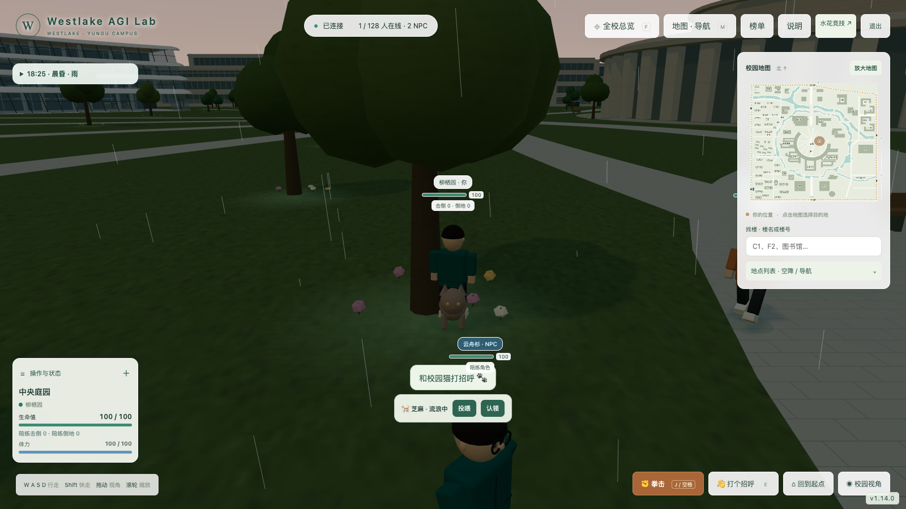

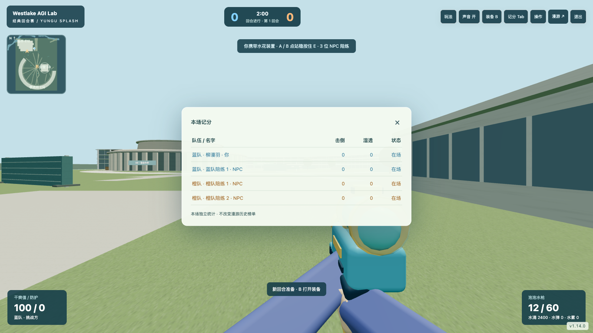

开发规则：NPC 行为由服务器决定，客户端不能创建 NPC 或指定命中 / 伤害。校园 NPC 的决策间隔为 200 ms，竞技 NPC 同样为 200 ms；竞技路线至多每两秒重新规划一次，使用构建阶段生成的 2 米碰撞导航网格。网格由 `scripts/build-water-navigation.ts` 根据校园和竞技几何生成，修改地图、碰撞或模式时必须重新构建，勿手改生成文件。运行时移动和射击继续核验真实碰撞，路线不会赋予穿墙能力。

正式服务默认启用 NPC；设置环境变量 `NPCS=0` 可关闭。内存测试的 `createGame` / `createWaterGame` 必须显式传入 `npcs: true` 才开启，避免旧真人对战用例受到自动补位影响。旧端到端测试默认关闭 NPC；[NPC 服务测试](tests/npcs.test.ts) 与 [NPC 浏览器测试](tests/e2e/npcs.spec.ts) 单独开启，覆盖单人开局、人数替换、空房间清理、碰撞、攻击与存档隔离。可运行 `node --import tsx scripts/npc-soak.ts`，使用内存数据库模拟三个竞技房间、三名真人和九名 NPC 的 150 秒运行，输出 `reports/npc-soak.json`。协议负载结果不代表同等数量真实浏览器的渲染性能。

## 测试与验收

### 日常检查

首次运行浏览器测试前需要安装 Google Chrome。项目配置使用 Playwright 的 `channel: 'chrome'`。如果选择使用 Playwright Chromium，需先执行 `npx playwright install chromium`，并调整 [playwright.config.ts](playwright.config.ts) 的 channel；单独下载 Chromium 不会改变当前浏览器选择。

```bash
npm run build
npm test
npm run test:paths
npm run test:e2e
```

| 命令 | 验证内容与运行方式 |
| --- | --- |
| `npm run build` | 生成导航缓存、TypeScript 检查、构建客户端和服务器 |
| `npm test` | 账号、楼宇搜索、移动 / 碰撞、导航、拳击和真实 Socket.IO 协议；使用内存或临时数据库 |
| `npm run test:paths` | 五条代表性路径的规划与连续移动检查 |
| `npm run test:e2e` | 启动独立的生产构建服务器和临时数据库，运行 Chrome 多页面、导航、搜索、账号、拳击及进程重启用例 |
| `npm run test:soak` | 独立临时端口上的 10 个协议客户端，默认持续 15 分钟 |
| `npm run report` | 根据已经存在的检查结果和证据生成 HTML 报告，不会自动运行所有测试 |

`npm run test:e2e` 默认占用 `3013`，可通过 `E2E_PORT` 更换，运行前应完成构建并确认测试端口未被其他服务占用。结束后脚本清理自己的服务和临时数据库。`SOAK_MS` 可调整协议长测时长；缩短后的结果应标明实际持续时间。

**不要把自动注册、移动、空降或拳击用例指向正式玩家数据库。** 推荐通过 `npm run test:e2e` 使用隔离环境。直接执行 `npx playwright test` 时，配置可能复用 `:3000` 已有服务；设置 `TEST_URL` 也会直接访问该目标，因此必须先确认目标为专用测试实例。

### 按修改范围补充验证

| 修改范围 | 至少关注的检查 |
| --- | --- |
| 文档 | 命令、路径、链接、参数和实际行为一致 |
| 楼名、代码、别名 | 楼宇测试；精确代码搜索、三维 / 地图高亮、返回视角 |
| 场景与共享物理 | 构建、物理 / 导航测试、路径检查；相关区域实走和视觉对照 |
| 账号与持久化 | 注册、并发重名、错误密码、重复在线、重连、退出、数据库重开与进程重启 |
| 拳击与复活 | 范围、朝向、遮挡、冷却、保护、血槽、多页同步和双方记录保存 |
| 竞技操作 | 体力消耗与恢复、前后方格挡、精准招架、重拳前摇与破防、闪避免伤与碰撞、失焦取消及窄屏按钮 |
| 地图、空降与导航 | 目标选择、安全落点、坐标拒绝、多页同步、重新规划、到达和取消 |
| 网络协议 | 正常 / 非法输入、断线恢复、序列与频率校验、跨页面同步 |
| 渲染性能 | 相关视角下的浏览器实测；必要时补充长测 |

检查应能发现行为回归；不为简单文档改动增加只复述实现的测试。已有测试通过后，仅在新改动、失败或未解决的问题需要时扩大验证范围。验证报告写清楚已通过、失败、未运行以及运行环境。

### 其他检查与报告工具

以下工具适合相关维护工作，部分有额外环境要求：

| 工具 | 用途 |
| --- | --- |
| `node --import tsx scripts/core-connectivity.ts` | 学术核心连接关系检查 |
| `node --import tsx scripts/region-physics-audit.ts` | 桥面、台阶、球场和道路等区域物理检查 |
| `node scripts/performance.mjs` | 前台 Chrome 与额外协议连接的性能长测；默认 `3012`、内存数据库和 15 分钟 |
| `node scripts/update-verification.mjs` | 路线、总览与联机的更新检查；使用独立测试服务 |
| `node scripts/clean-install.mjs` | 在临时目录做干净安装、构建和启动检查 |
| `node scripts/capture-regions.mjs` | 分区截图；需要已运行的测试服务 |
| `node scripts/loading.mjs` | 页面加载与外部请求检查；需要已运行的测试服务 |
| `node scripts/export-evidence.mjs` | 将已有 Playwright 录屏和 trace 整理到报告目录 |
| `node scripts/verify-report.mjs` | 验收报告内容及证据检查 |
| `node scripts/package.mjs` | 生成交付包；GitHub 发布前仍需检查包内报告和素材的许可 |

性能和更新检查脚本包含 macOS 硬件信息命令，换到其他平台需要适配。独立 Node 测试进程也会继承启动环境：特别是干净安装等工具，不应带入指向正式数据库的 `ACCOUNT_DB`。截图 / 加载工具会操作目标网页并可能注册测试账号，运行前检查它们的地址设置。

运行验收脚本后可在本机查看 `reports/acceptance.html`；相关日志、截图、录屏和 trace 位于 `reports/` 或测试输出目录，不随公开仓库提交。报告不是持续集成状态；当前仓库没有自动 CI 流程和覆盖率承诺。功能验证通过也不代表测绘精度或校方确认。

## 部署与数据维护

### 部署自己的服务

服务器需具备满足版本要求的 Node.js。普通自托管不需要运行本项目维护者的远程脚本。

1. 在构建环境执行 `npm ci` 和 `npm run build`，完成与改动相关的验证。
2. 将 `dist/`、`dist-server/`、`package.json` 和 `package-lock.json` 放入同一发布目录；如使用源码同步工具，还需保留它列出的源码文件。
3. 在该发布目录安装运行依赖：

   ```bash
   npm ci --omit=dev
   ```

4. 用部署环境自己的 `.env` 或进程环境指定监听地址、端口和数据库绝对路径。数据库置于发布目录之外，例如：

   ```dotenv
   HOST=0.0.0.0
   PORT=3000
   ACCOUNT_DB=/srv/westlake-campus/shared/accounts.sqlite
   ```

5. 从发布目录启动 `npm start`，检查 `/health`，再用专用测试实例验证注册、联机和存档。正式服务的运行目录必须包含 `dist`，否则静态资源无法正确提供。
6. 需要常驻运行时使用所选平台的进程管理方式。Linux 服务示例见 [deployment/westlake-campus.service](deployment/westlake-campus.service)；修改用户、Node 路径、工作目录、环境和数据库路径后再安装。

Node 服务本身提供 HTTP，不内置 TLS。公开服务应通过反向代理提供 HTTPS / WSS，并正确转发 `/socket.io/` 的 WebSocket 升级请求，避免账号密码通过公开的明文 HTTP 连接传输。静态网页与 Socket.IO 保持同源配置。当前认证限流使用 `socket.handshake.address`；经过代理后需核对该值是否代表玩家地址，若都是代理地址，所有玩家会共用一份认证限额，需相应适配。

单实例服务对应一个最多 128 人的房间。扩展到多个进程或多台机器前，需要实现房间状态协调和连接路由；直接把多个独立实例放在负载均衡后，不会自动形成同一个校园房间。

### 更新与回退

推荐使用独立发布目录，例如 `releases/<版本>`，以及指向当前版本的 `current` 链接；数据库统一放在 `shared/`。发布时先完成源码合并、构建和验证，再切换版本并正常重启游戏进程。

- 发布包和同步内容不能覆盖、删除或替换现有玩家数据库。
- 发布后检查健康状态与相关功能；需注册账号或进行互动的验收使用隔离数据库。
- 回退通常切回前一版本并重启，但如果更新涉及数据库迁移，必须先确认旧程序能读取新结构，或执行预先准备的迁移回退方案。
- 不将发布服务器的 `.env`、账号存档或 SSH 凭据打包到源码和公开报告中。

现有维护环境的具体操作记录见 [服务器部署](docs/deployment.md)。其中的路径、地址和服务名属于维护者配置，Fork 项目后需要替换。

### 存档维护

SQLite 文件包含账号认证信息和玩家存档，只提供给后端使用，不放入 `public` 或静态资源目录。当前代码在支持 POSIX 权限的平台上创建受限目录和数据库文件，并使用 WAL、完整同步和忙等待配置。

备份运行中的 SQLite 时使用支持在线备份的 SQLite 工具，或先正常停服再备份完整数据库状态。**不能只复制正在写入的主 `.sqlite` 文件而忽略 WAL 中的更新。**恢复前停止相关服务，确认备份完整性、数据版本和文件权限，再启动验证。

旧账号分离迁移已提供：构建后，正常停服并备份，再执行 `node dist-server/migrate-accounts.js /absolute/path/to/accounts.sqlite`。工具只接受已有文件，核对原认证与游戏字段保留。账号管理和密码重置功能尚未实现；后续扩展需处理身份校验与兼容，不在网页暴露数据库操作接口。

## 双向源码同步

本项目现有维护流程要求：**每次发布都先合并本地和服务器相对上次核验版本的改动，再发布合并结果**。普通试玩、文档编辑和没有远程部署的 Fork 无需运行该工具。

[scripts/sync-source.py](scripts/sync-source.py) 使用 `.sync-base/source.tar.gz` 作为三方合并基线：

- 本地或服务器单侧改动会保留；双方文本改动可自动合并时生成合并结果。
- 同一处冲突、无法合并的二进制文件或删除冲突会列出并停止，不应用部分合并计划。
- `--merge` **只把服务器改动合并到本地**，不会上传、构建或重启远程服务。
- `--record` 仅在双方所有纳入同步的源码一致时写入新基线，不能用来掩盖尚未发布的差异。

脚本不内置远程服务器地址。使用时替换下方占位值，并显式提供 `--host` 和 `--remote-root`；需要可用的 SSH 非交互认证、双方 Python 3，以及本地 Git。若不存在输出目录，先创建 `reports/`。

```bash
mkdir -p reports
python3 scripts/sync-source.py --merge --host USER@HOST --remote-root /ABSOLUTE/PATH/current
```

合并成功后检查差异、构建和验证，按自己的部署流程上传完整合并版本。发布完成且源码核对一致后再执行：

```bash
python3 scripts/sync-source.py --record --host USER@HOST --remote-root /ABSOLUTE/PATH/current
```

首次建立基线时，先使双方源码确实一致，再执行 `--record`。已有部署缺少基线时应恢复上一次已核验的基线，不用某一侧当前版本假装共同祖先。冲突需要人工合并后复查；操作审计输出为 `reports/source-sync-audit.json`。

同步范围包含源码、共享规则、场景数据、测试、文档、配置模板和参考资料清单。数据库、`.env`、依赖目录、构建产物、报告、参考原图和发布记录 `deployment/release.json` 不参与同步。**源码同步不等于账号数据同步。**

原维护环境的 `AGENTS.md` 和 `docs/PROGRESS.md` 是本地工作记录，不提交。公开部署说明使用模板；`scripts/verify-deployment.mjs` 通过 `DEPLOY_URL`、`DEPLOY_SSH_HOST` 指定验证目标。重启检查仅在设置 `DEPLOY_VERIFY_RESTART=1` 时执行，必须连接独立测试房间。

## 参与贡献

### Issue

提交问题时请提供：

- Node.js、操作系统和浏览器版本，使用开发模式还是生产构建。
- 复现步骤、预期行为和实际结果；涉及地图时给出楼号或位置。
- 相关控制台 / 服务端错误；日志和截图先移除密码、令牌及玩家私人数据。
- 场景纠错附公开资料链接，说明它支持名称、外观、位置或哪一项尺寸。

新功能建议说明玩家要解决的问题、预期入口和规则变化。未确认的资料标明推测，避免只给出“看起来不对”而没有可以核对的依据。

### Pull Request

1. Fork 后创建主题分支；本项目默认使用 `codex/` 分支前缀。
2. 完成一个边界明确的改动，保持无关格式化和依赖升级独立。
3. 根据修改范围执行构建和相关验证，附命令、结果及未验证部分。视觉变化附前后截图，资料修正附来源。
4. 同步维护文档、共享类型、生成数据、迁移说明与素材许可。
5. PR 描述先写具体问题与修改后的行为，再写验证和必要的兼容说明。不要提交密码、令牌、账号数据库或个人环境配置。

项目没有要求贡献者连接维护者服务器。未经维护者安排，不操作现有线上环境；可以使用自己的实例或临时数据库验证。

### 版本号维护

`package.json` 的 `version` 是唯一版本来源；`shared/version.ts` 供界面和服务器读取。每一轮完成的改动发布前必须更新版本号，同时完善 README；同一版本的反复构建和验证不重复递增。

```bash
npm run version:patch  # 普通调整、修复或文档更新：1.1.0 → 1.1.1
npm run version:minor  # 新增兼容功能：1.1.1 → 1.2.0
npm run version:major  # 不兼容更新：1.2.0 → 2.0.0
npm run build
```

命令同步修改 `package.json`、锁文件中的项目版本和 README 当前版本，不创建 Git 标签、提交，也不上传文件。发布清单应记录 `appVersion`；发布后核对页面与 `/health` 的版本和构建哈希。日期格式的 release 目录继续用于部署与回退，游戏版本和数据库结构版本分别维护。构建成功之后才能发布，不要只改网页显示数字。

### GitHub 公开仓库

本仓库以含 `package.json` 的目录为根，使用 `main` 分支。v1.12.0 新增第一人称水花竞技，保留原校园漫游；首次公开不包含历史内部提交、原维护服务器配置、存档或参考原图。维护与发布时逐项检查：

- 提交源码、锁文件、必要数据、测试、文档、`LICENSE` 和 `.env.example`，确保干净克隆可以按快速开始运行。
- [当前 .gitignore](.gitignore) 已排除依赖、构建目录、环境秘密、运行数据库、测试输出、同步基线、部署清单和内部工作记录。`references/` 仅提交来源清单 `manifest.json`，参考原图与整个 `reports/` 不提交。
- 参考照片、图纸和裁剪对照图逐项核对再分发许可。未获得许可的文件不要上传 GitHub 或公共 Release，可保留来源清单和获取说明。
- 检查报告、录屏、trace、部署记录和维护文档中的个人路径、服务器配置与账号信息。把环境专属设置改为模板，保留必要的资料出处。
- `.gitignore` 不会删除已跟踪文件或清理提交历史；公开已有历史前也需检查历史中的私密内容和素材。
- 历史报告体积较大，只保留许可明确且有用的示例；报告缺失不影响普通构建和试玩。清楚标注报告对应的版本和环境。
- 完成一次干净安装、构建和相关测试后，再公开仓库并设置真实的项目链接。不要放置未建立的 CI、覆盖率或校方认可标识。

`package.json` 的 `private: true` 用于防止误发布到 npm，不影响在 GitHub 公开源码。

## 源码与素材许可

| 内容 | 许可与使用方式 |
| --- | --- |
| 本项目原创代码与生成资产 | [MIT License](LICENSE)；分发时保留版权和许可文本 |
| npm 第三方依赖 | 各自许可证，不能统一改标为 MIT |
| OpenStreetMap 衍生定位 / 地图资料 | 楼宇目录已记录 © OpenStreetMap contributors 和 ODbL 1.0 标注；复用相关数据时保留其来源与许可说明 |
| 参考照片、图纸及其裁剪对照图 | 不属于本项目 MIT 许可；原权利人保留权利，公开分发前逐项确认授权 |

运行中的校园几何和材质由本项目生成，参考原图不作为地面航拍贴图，也不进入 `dist` 或 `public/assets`。但参考图以及部分报告中的对照图片仍可能存在于开发目录，运行资产的许可不能代替这些图片的再分发授权。

当前参考清单包含 52 条资料记录，见 [references/manifest.json](references/manifest.json)；楼宇目录的定位资料与修正依据另见 [data/building-directory.json](data/building-directory.json)。新增第三方资产或数据时，在资料清单中记录作者、来源、许可和用途，并说明是否允许随源码 / 发布包分发。

项目名称、校园原型和资料引用不表示校方参与或认可。MIT 许可范围和责任说明以仓库 `LICENSE` 为准。

## 常见问题

**白屏或 WebGL 不可用**：检查浏览器控制台，使用支持 WebGL 的浏览器并开启硬件加速；确认 `npm run build` 成功且服务在正确工作目录启动。

**无法连接或其他设备访问不了**：确认 Node.js 进程在运行、端口一致。局域网访问需要 `HOST=0.0.0.0` 和相应网络连通条件；浏览器地址应使用服务机器的地址。开发模式使用 `npm run dev`，不要只启动 Vite。

**更改代码后没有生效**：前端开发模式通常热更新；后端和服务端共享数据变化需重启开发命令。正式构建需重新运行 `npm run build`、重启 Node.js，再刷新网页。

**用户名不能注册或登录**：登录用户名是自己指定的 3–32 个字符，公开显示名字才使用三组候选字。检查用户名格式、密码和是否已在其他页面在线；重复用户名只能登录，同一显示名字可以用于不同账号。旧账号继续使用原三字用户名登录。

**换台服务器后没有原位置和记录**：账号与存档保存在各自服务器的数据库，不跟随源码。没有实现跨服务器账号合并功能。

**角色卡住或目标不能步行到达**：点击“回到起点”，或改选安全位置空降。水面和楼体不可直接穿过；导航失败时选择附近入口。若确认模型或碰撞有问题，提供楼号 / 坐标和复现步骤。

**浏览器测试找不到 Chrome**：安装 Chrome，或下载 Playwright Chromium 并修改浏览器 channel。测试前先构建，使用 `npm run test:e2e` 启动隔离服务。

**Vite 原生 binding 缺失**：确认使用受支持的 Node.js，执行 `npm ci --include=optional`；不要省略构建所需的可选依赖。

**Fork 后同步脚本失败**：普通开发不需要远程同步。需要时先替换目标配置、准备 SSH 认证、建立匹配基线，再查看冲突报告；不要绕过冲突强行覆盖某一侧源码。

### 紧凑侧栏（v1.7.1）

左侧默认只保留当前位置、显示名、生命值和体力（复活保护期间也显示保护倒计时），点击「操作与状态」的＋展开对打记录、闪避／格挡／重拳按钮和车辆操作，再点击−收起。键盘快捷键在收起后仍可使用。靠近汽车、校车或乘车时，车辆卡片自动出现，方便随时上下车；离开后自动收起。天气与时间保持独立的折叠入口。展开状态仅影响本次页面，不写入帐号存档。

开发时将左侧卡片放在 `#left-rail` 的纵向流布局中，通过 `.expanded` 与 `.transport-context` 控制细节，避免再用多个绝对定位的 bottom 值叠加面板。窄屏和矮屏限制侧栏高度并允许内部滚动；生命与体力的进度条、原有按钮 ID 和快捷键保持可访问。新增功能优先按需展开或按场景显示，不默认堆叠说明文字。

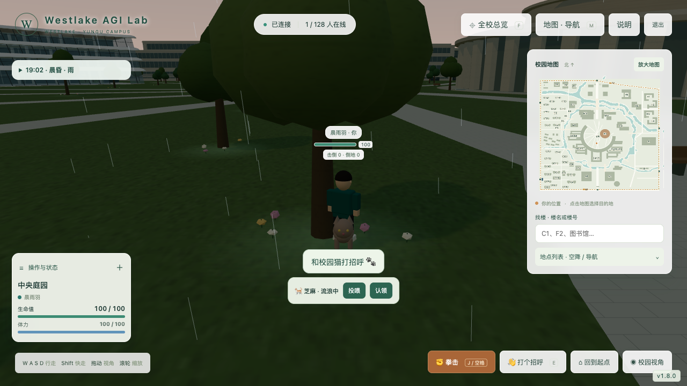

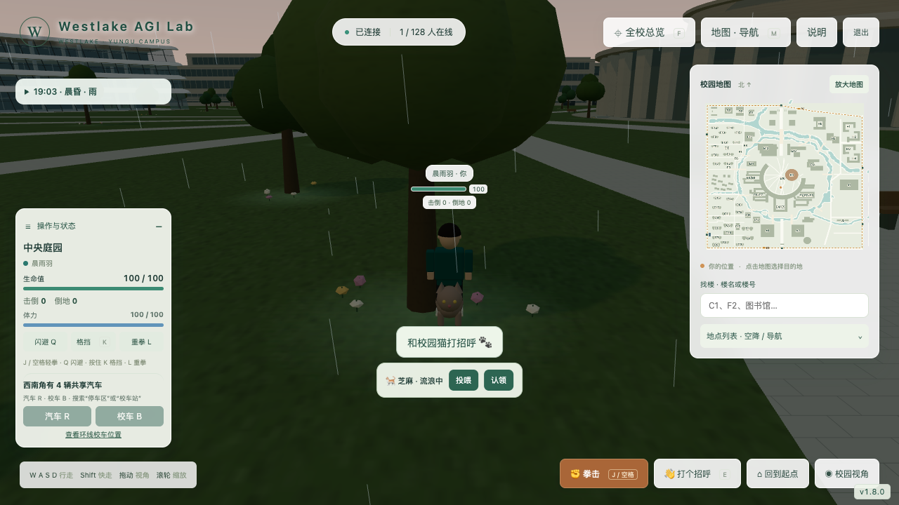

### 校园猫狗（v1.8.0）

校园共有四只猫、三只狗。展开天气卡，点击「寻找校园猫／狗」查看它们的位置，再通过地图空降或步行靠近。四米内出现互动卡：

- **投喂**：不用道具或积分，猫狗短暂停下吃东西，出现食盆和爱心；同一只动物每三秒可投喂一次，所有玩家都能看到。
- **认领**：每人最多一只猫和一只狗，一只动物只能归一位玩家。认领后戴上绿色项圈并跟随主人；猫只陪伴，狗可协助对打。
- **解除认领**：附近互动卡或左侧「我的猫狗」都可以操作，表示玩家所说的放弃宠物；它会留在当前位置附近重新游荡，其他人可认领。只能解除自己的认领，乘车时请先下车。

没有任务、奖励、养成数值或饥饿惩罚。原来的简单打招呼仍可使用。认领关系保存到当前服务器，刷新、退出重登和重启后保留；主人离线或乘车期间宠物暂时隐藏且不攻击，下车／重新登录后继续跟随。遇到空降、复活或长时间被建筑挡住时，它会在主人附近的安全地面赶上来。

狗仅协助主人刚刚打中的目标（包含格挡），不会自行挑衅。协助窗口三秒，主人距目标不超过八米，狗距目标不超过四米且中间无墙壁或车辆；每次最多八点伤害，间隔至少 1.2 秒。对手闪避、复活保护和乘车仍受保护，正面格挡／招架同样有效。狗造成的击倒记入主人的记录；动物本身不作为可攻击目标。投喂和认领不增加生命值或对打属性。

开发入口：`shared/pets.ts` 定义固定动物、权限、互动和跟随规则；`server/game.ts` 权威执行互动与狗的协助，`world.pets` 同步公开状态；`client/pets.ts` 提供就近互动及折叠的认领名单，`client/ambience.ts` 绘制猫狗、项圈、食盆、爱心和扑击动作。不要信任客户端传来的主人、位置、伤害或冷却；请求仅接受 `{id,kind}`，并校验距离、归属及频率。猫狗不阻挡玩家或车辆。手机互动入口放在右侧，避免遮挡左侧生命和体力。

存档新增独立的 `campus_pets` 表，记录固定动物 ID、主人帐号 ID、位置和解除认领后的游荡中心；没有改写帐号认证、原位置、对打记录或外观字段。启动时以 `CREATE TABLE IF NOT EXISTS` 幂等创建，帐号结构版本仍为 3；v1.7.1 可忽略新表并读取原帐号，退回旧版期间宠物不会活动。投喂爱心、攻击意图和冷却是临时状态，重启清空。发布前按既有 SQLite 维护规则备份，源码发布包不含任何运行数据库。

验证：`tests/pets.test.ts` 覆盖权限、并发认领、投喂冷却、协助伤害、解除转让、隐私和临时数据库重启；`tests/e2e/pets.spec.ts` 使用双浏览器验证操作、同步、跟随、刷新与窄屏入口。

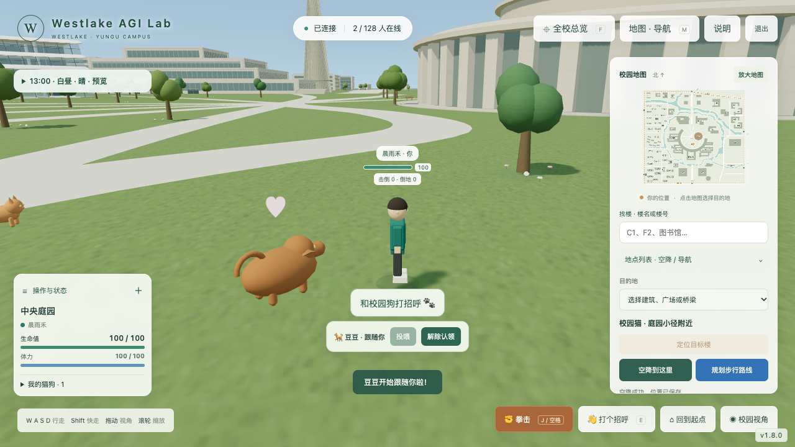

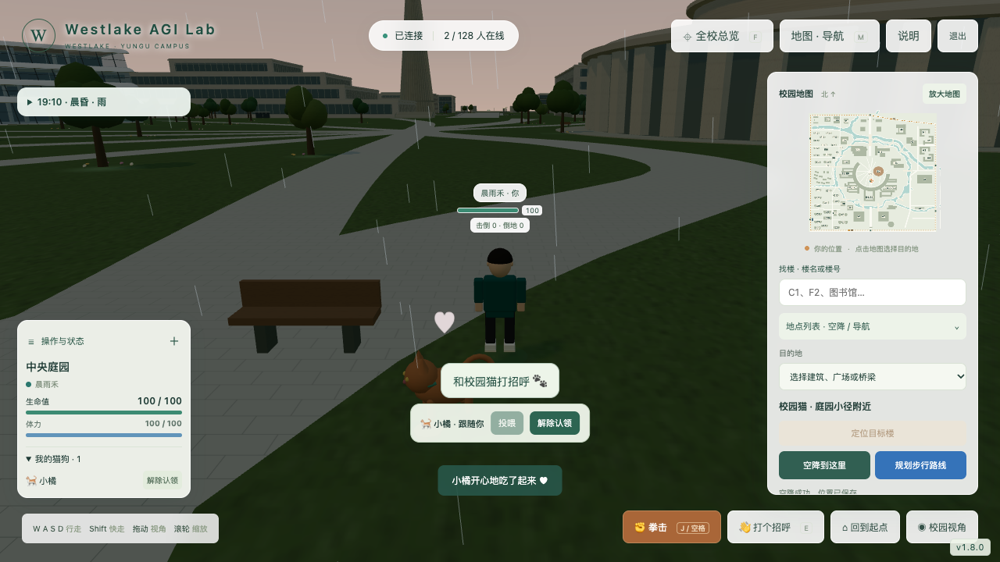

### 游戏内操作说明（v1.8.1）

登录前的「操作说明」和游戏内的「说明」共用操作速查，仅列出移动、视角、地图、动作、车辆的按键和界面操作。点击 × 或按 Esc 关闭。窄屏采用单列，并允许在弹窗内滚动。游戏机制、数值、认领与对打规则、彩蛋、模型来源和还原限制继续保留在 README 与开发文档，游戏内说明不介绍这些内容，让玩家自行探索。

开发时保持说明为操作索引，不向该弹窗加入玩法攻略、机制数值、任务或彩蛋提示。新增输入方式时更新对应操作项；详细规则写入 README。

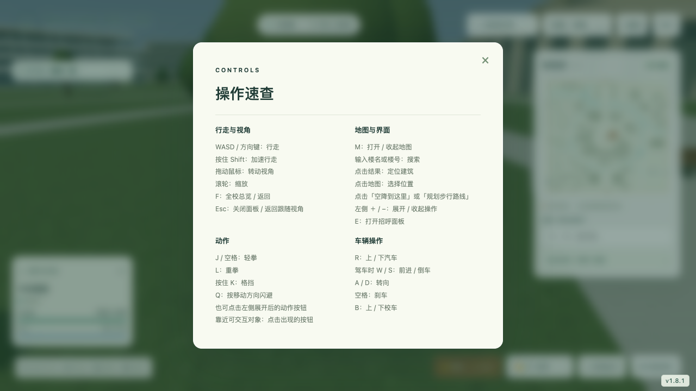

### 水岸钓鱼彩蛋（v1.9.0）

校园西南侧一处水岸放了小凳、鱼竿和水桶，木牌写着「水边坐坐」。这是游戏添加的场景道具，位置不是校方公布的钓鱼点。玩家走近三米内会出现「抛竿」按钮：站稳抛竿后视角朝向水面（仍可拖动和缩放），看浮漂，出现动静时点击「收竿」。不要在游戏内说明、地图搜索或常驻侧栏直接展示该彩蛋，让玩家在场景中发现。

等待时间随机为 4–8 秒，上钩后的收竿窗口为 2.4 秒；过早或过晚会空竿。及时收竿大多数是一尾普通小鱼，偶尔遇见金色小鱼，也有小概率捞起带纸条的漂流瓶。鱼会放回水里，收获展示四秒后消失，不加任务、货币、装备、积分、排行榜或背包。钓鱼不会改变生命、体力、尺寸和对打记录。

移动离开抛竿位置 1.5 米、出拳、受伤、闪避、格挡或乘车会结束这一竿；也可随时点击「放下鱼竿」。多人可以同时在岸边钓鱼，并看到彼此的鱼竿、鱼线、浮漂和收获。每人的状态独立，不能替别人收竿。手机互动卡放在右侧；岸边暂时隐藏猫狗的就近互动卡，离开后恢复，认领名单不受影响。

开发入口：`shared/fishing.ts` 定义固定岸边 `(-148, 296)` 与水面 `(-148, 304)`、请求校验和 `FishingRoom` 状态机；`server/game.ts` 用服务器时钟处理抛竿、咬钩、收竿、打断和退出清理；`client/fishing.ts` 绘制道具、共享鱼线、浮漂及轻量收获反馈。`world.fishing` 只发布当前阶段、抛竿位置及展示结果，不发布未来咬钩时间；客户端只发送 `{kind: 'cast' | 'reel' | 'cancel'}`，不能提交时间、收获或其他玩家 ID。场景模型复用同一玩家的鱼具，离线时释放几何和材质，避免重复抛竿累积渲染资源。

钓鱼状态与收获仅在当前在线会话展示，刷新、退出和服务器重启时清空；不写入帐号存档，不新增或改动数据库表。新增点位时核验岸边可走、水面确实落在水体多边形内且已有步行路线。测试入口：`tests/fishing.test.ts` 验证时机、权限、碰撞位置、打断和真实协议同步；`tests/e2e/fishing.spec.ts` 使用双页面验证场景操作、共享状态与手机布局。

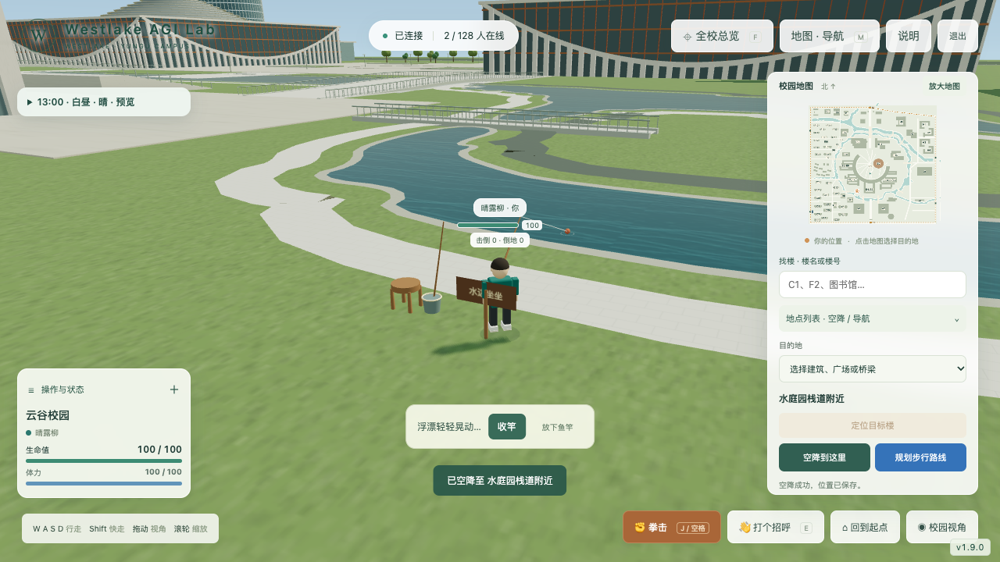


### 树荫里的熟果（v1.10.0）

校园里新增三棵小果树，分别结苹果、柿子和梨，枝头混有青果与熟果。这些树和果子是游戏添加的装饰与互动，不代表校园真实植物品种或现实采摘区域。靠近三点五米内出现「摘一颗」按钮，点击后熟果短暂落到角色手边，偶尔出现一颗金色果子的小惊喜。游戏内说明、地图搜索和常驻侧栏不展示彩蛋入口，供玩家在漫游中发现。

每棵树六颗果子，初始五颗成熟、一颗继续生长；摘下后这颗会消失片刻，再长出青果，约九十秒重新成熟。颜色和大小随服务器时间变化，天气／时段预览不会加速成熟。树的成熟状态由所有玩家共享，同一颗果子不能重复摘，其他人摘走后你也能看见变化。角色的摘果展示持续 3.5 秒，没有任务、积分、背包、属性加成或持久收集记录。离线不退还已经摘掉的熟果。

采摘需要靠近并保持可操作的站立状态，乘车、闪避、格挡、重拳或硬直时不能摘；连续采摘间隔至少 700 毫秒。不需要额外快捷键，手机可点击右侧就近互动卡。靠近果树时暂时隐藏猫狗的就近互动卡，离开后恢复；猫狗认领名单仍可访问。树与道具不新增道路障碍；周围预留小片空地，避免大树树冠挡住近距离镜头。

开发入口：`shared/fruit.ts` 提供固定果树、果实槽位、成熟与再生规则、请求校验和 `Orchard`；`server/game.ts` 权威校验距离、动作状态、频率和成熟时间，成功后同步 `world.orchard`；`client/fruit.ts` 绘制枝头果实、成熟颜色、摘下飞向角色的动画和按需互动卡。请求仅接受 `{treeId, fruitId}`，不接受客户端提交成熟时间、收获、玩家 ID 或位置。同一果实的检查与更新在服务器同步完成，防止并发双领。模型与材质在初始化时创建并复用，不为每次采摘生成新场景对象。

当前游戏果树中心是 `(22, 92)`、`(-105, 45)`、`(142, 90)`。新增点位需核验共享碰撞规则允许站立、可从起点规划步行路线、果子在树冠外侧可见。成熟状态仅保存于当前房间内存，服务器重启重新生成；不改变帐号数据库结构、位置或对打记录。单元与真实协议检查见 `tests/fruit.test.ts`，双浏览器和手机验收见 `tests/e2e/fruit.spec.ts`。

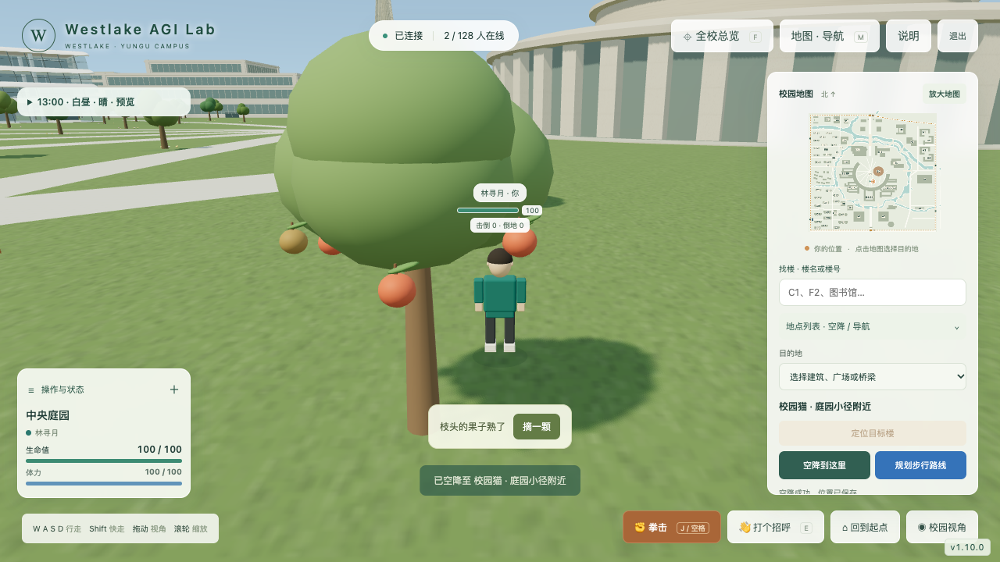

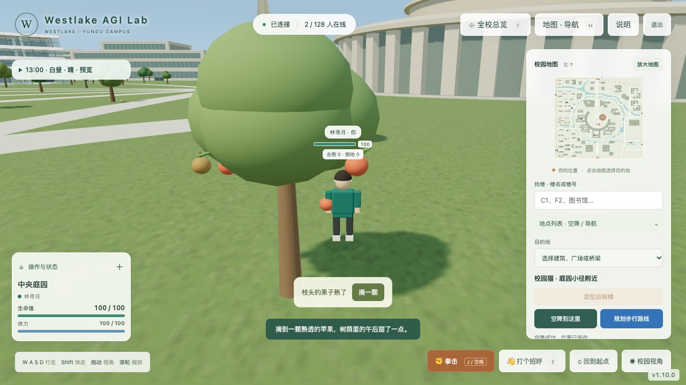

## v1.13.0 竞技扩展与复测

开发时修改 `shared/water-modes.ts` 管理玩法、房间容量与地图范围，`shared/water.ts` 管理水枪射程、伤害衰减、移动散布和回摆参数。客户端与服务器移动、射线和目标点必须使用同一玩法地图；不可只缩小画面而保留原碰撞。`server/water.ts` 权威处理装备掉落、拾取、归队、保护与积分，新增规则不得写回漫游记录。声音事件只发给房间内附近玩家，客户端 `client/water-audio.ts` 使用一个共享噪声缓冲和最多 12 个短音源；`client/water-drops.ts` 用固定实例池绘制地上装备，避免每次掉落分配模型。

规则与真实连接测试见 `tests/water-modes.test.ts`；桌面 / 手机玩法切换、声音开关和带水量拾取见 `tests/e2e/water-modes.spec.ts`。复测：`npm run build`、`npm test`、`npm run test:e2e -- tests/e2e/water-modes.spec.ts tests/e2e/water.spec.ts tests/e2e/water-visuals.spec.ts tests/e2e/appearance.spec.ts`。测试使用临时或内存数据库。

三房间协议负载复测命令：`node --import tsx scripts/water-playlists-soak.ts`，默认 30 秒、40 个真实协议连接（24 参赛 + 16 观战），分别进入经典 20、小场 10、快速 10 个连接；报告写入忽略的 `reports/water-playlists-soak.json`。这验证服务器协议与同步，不代表 40 个渲染浏览器的帧率。远程复测必须使用隔离测试服务和单独数据库，具体方式见 [竞技开发说明](docs/water-mode.md)。

2026-10-11 v1.13.0 本地验证：61 项规则与真实协议测试通过；桌面 / 手机玩法、经典竞技、持枪特效与共享角色定制共六个浏览器用例通过。三房间 40 协议连接持续 30 秒（24 参赛 + 16 观战），经典 / 小场 / 快速快照到达间隔 P95 分别 199 / 202 / 204ms，操作确认 P95 11.6ms，事件循环 P95 11.6ms，进程 RSS 最高 234MB，无断线或确认超时。单次平均快照约 10.9 / 5.7 / 5.9KB；目标发送 10Hz，但慢连接和发送繁忙时会丢弃快照，此次负载下间隔接近 200ms。结果来自开发机、单次短时协议负载，不能代表远程网络或手机渲染表现。

## v1.13.2 交通防卡住修复

校车和小车使用 `shared/traffic-geometry.ts` 的旋转矩形分离轴碰撞，校车不再由三个大范围虚拟小车代替。已有接触仅允许减轻接触或向外脱离，不能进一步撞入其他车辆；建筑、水面、边界和行人检查继续生效。`stepShuttleTraffic` 在等待后按最多 4 米/秒尝试侧向推车，受阻 6 秒后搜索有限的安全落点，最多每秒触发一次恢复搜索。没有安全位置时继续等待，不能把车辆塞进障碍物或通过任意位置请求挪车。

校车清障只修改房间车辆的位置和速度，保留车 ID、司机、乘客和个人记录；司机与乘客由同一服务器 tick 同步。`createGame.initialTraffic` 仅供可信服务器代码和内存测试房间指定初始堵路场景，不接受客户端或环境变量设置。新回归见 `tests/traffic.test.ts`、实际双浏览器的 `tests/e2e/traffic.spec.ts`；复测原有驾驶、交接、校车上下车用例。正式玩家数据库不用于测试。

校车堵路清障、司机和乘客位置同步、清障后继续驾驶的隔离浏览器场景已通过；全量 66 项规则 / 协议测试及三个交通浏览器用例通过。

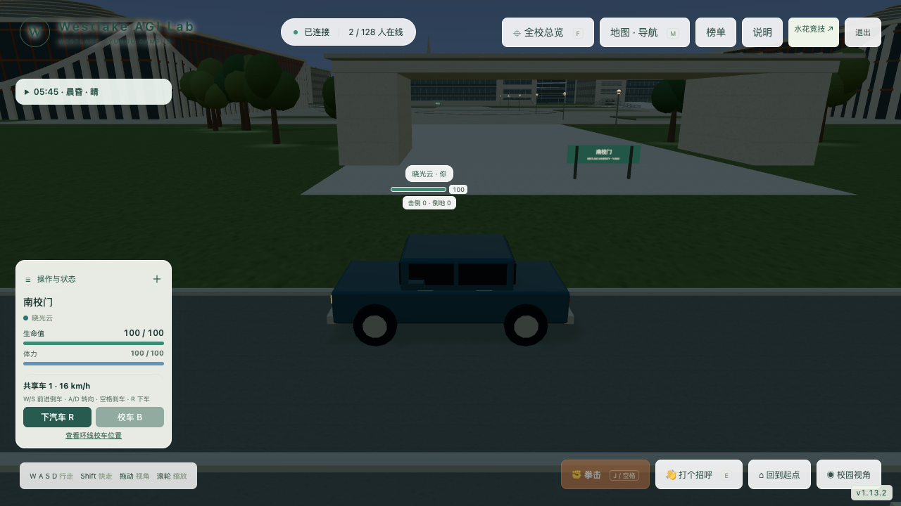
