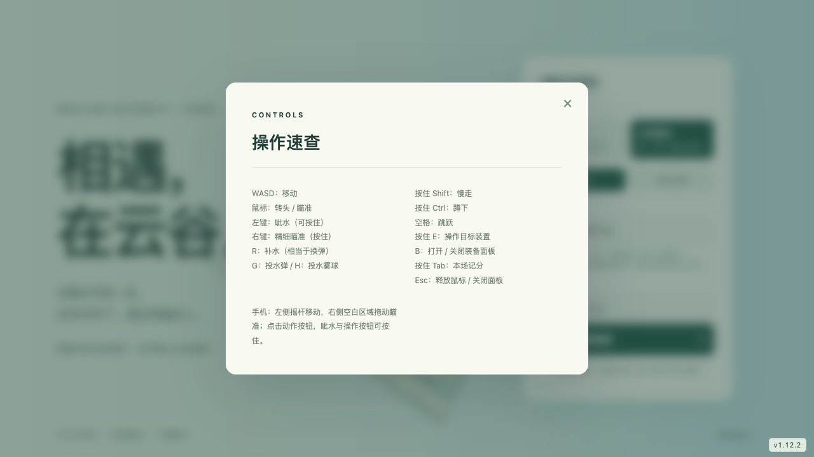
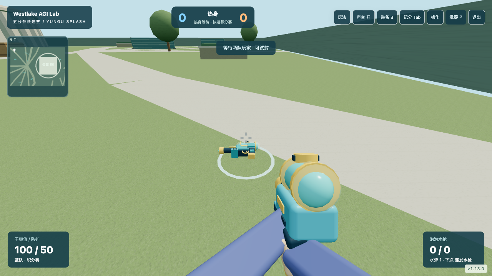
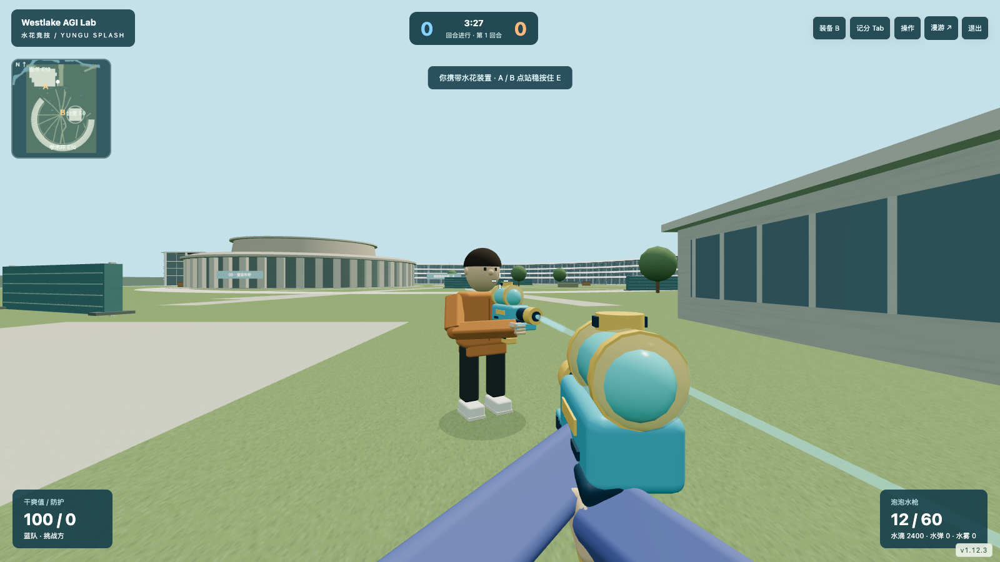

# 水花竞技（v1.13.0）

水花竞技是独立于云谷漫游的第一人称团队模式，使用明亮的玩具水枪、水弹、水雾球和水花装置。借鉴经典战术射击的回合、经济、双目标点和观战结构，装备、场景和规则由本项目原创实现；没有真实枪械、血腥效果，也没有引入商业游戏素材。

## 进入与账号

登录界面的两张模式卡可在「云谷漫游」与「水花竞技」之间选择。漫游入口 `/`，竞技入口 `/water.html`；使用同一套注册、密码、公开名字和外观。退出当前模式后可切换，同一账号不能同时在两个模式或多个页面在线。离开水花竞技不会覆盖漫游位置、击倒 / 倒地次数、外观或猫狗归属；竞技记录和装备只属于当前比赛会话，离开重进重新分配初始装备与水滴。

经典竞技房间最多 20 个连接，10 个参赛位（蓝 / 橙队各 5 人）与最多 10 个候场观战位，按人数自动分队。有空位时观众自动获得队伍；关闭 NPC 时，进行中的回合新加入者先观战，下一回合上场；开启 NPC 时有参赛空位可直接上场。至少每队一人即可开局，允许 1v1、2v2，服务器默认为每队不足两人的房间补入明确标注的 NPC，最多三名；真人优先替换，空房间不保留 NPC。NPC 伤害较弱，不占真人连接名额。关闭 NPC 且只有一队时进入热身，可移动、试射、补水和选装备，不计胜负。

## 第一次玩：从登录到一回合

1. 登录时选「水花竞技」，点击「进入视角」。鼠标会被游戏捕获，移动鼠标就是转头；按 Esc 可恢复鼠标指针，操作装备、记分或退出按钮，再点击「进入视角」继续。
2. 先在热身中用 WASD 走动，把屏幕中央的准星对准目标，按住左键呲水。只有自己一人时可以试操作，至少两人分到两队后才开始计分回合。
3. 每回合先有 15 秒准备时间，角色暂时不能走动。按 B 打开装备，用「水滴」选购，再关闭面板、进入视角。水滴是比赛里的装备额度；选新水枪会替换手上的水枪。
4. 留意右下角的水量。**例如 `12 / 60`，左边是现在能连续呲出的次数，右边是备用储水。按 R 补水，相当于这类游戏的“换弹”**：把备用储水补进当前水枪，等待 1.0～2.3 秒，显示「补水中…」时不能呲水。没用完也能提前补水；备用储水为 0 时无法再补，下一回合重新补满。R 不用于切换水枪。
5. 左下角显示自己的队伍和「挑战方 / 守护方」。挑战方把装置带到小地图 A 或 B 点，站稳按住 E 启动；守护方阻止启动，已启动时靠近装置、站稳按住 E 关闭。屏幕上方和提示会显示剩余时间，操作时有进度条；中途松开 E 或走动会打断。
6. 「干爽值」表示还能承受多少水花，降到 0 就是「湿透」：本回合自动观战，不能继续移动或呲水，下一回合满干爽值归队。无需重新登录。准备阶段和观战时暂时不能走动都属于正常规则。

想了解回合如何得分、多久需要完成目标、湿透后丢失哪些装备，可以看后面的「回合与目标」和「装备与经济」。

## 操作速查

| 按键 / 操作 | 用途 |
| --- | --- |
| W / S / A / D | 向前 / 后退 / 向左 / 向右移动，方向随当前视角变化 |
| 移动鼠标 | 转头和瞄准，中央准星表示呲水方向 |
| 按住鼠标左键 | 连续呲水，水量耗尽时停止 |
| 按住鼠标右键 | 精细瞄准，视野缩小；松开恢复，精确水枪放大更明显 |
| **R** | **补水（相当于换弹）**，从备用储水补充当前水枪，补水过程中不能呲水 |
| G | 投出一颗携带的水弹，落地后溅射附近区域 |
| H | 投出一颗携带的水雾球，形成暂时遮挡视线的水雾 |
| Q / F | 丢出水枪 / 拾取 1.8 米内且无遮挡的地上水枪，保留剩余水量 |
| 按住 Shift | 慢走，脚步更轻 |
| 按住 Ctrl | 蹲下，降低视点并减小射击散布；松开站起 |
| 空格 | 跳跃 |
| 按住 E | 靠近目标装置、站稳操作，保持按住直到进度条完成 |
| B | 打开 / 关闭装备；经典 / 小场在热身或准备阶段选购，快速赛选下次入场装备 |
| 按住 Tab | 查看本场队伍、击倒和湿透次数，松开关闭；也可点击「记分」按钮 |
| Esc | 释放鼠标 / 关闭面板，之后点击「进入视角」恢复第一人称操作 |

手机：左侧摇杆移动，右侧空白区域拖动瞄准；「呲水」和「按住操作」可长按，「瞄准」和「蹲下」点按切换状态，「补水」就是 R 的功能。点击「水弹 / 水雾」会投出已购买的对应物品，点击「装备」选购或选择下次水枪，点击「记分」看本场记录；「丢枪 / 拾取」对应 Q / F，顶部「玩法」切换比赛，「声音」开关方向声音。

## 常见操作疑问

- **左键没反应？** 先点击「进入视角」，确认自己在场、回合允许操作，当前水量不为 0，且没有正在补水或打开面板。水量为 0 就按 R；回合赛湿透后等下一回合，快速赛等 4 秒归队。
- **R 为什么没反应？** 水枪已满、备用储水为 0，或仍在准备 / 观战阶段时不能补水；连续按 R 不会缩短补水等待。
- **G / H 为什么没有东西扔出去？** 先在热身或准备阶段按 B 购买对应物品，右下角会显示剩余数量，正式对局中需等待回合开始，热身时也可以试投。
- **E 为什么没有进度？** 挑战方需携带装置并在 A / B 点附近；守护方需靠近已经启动的装置。站稳、不跳跃，并持续按住 E。
- **为什么人物刚加入不能动？** 两队凑齐后进入准备阶段；在已经开始的回合中加入，或参赛位满员时，会先观战。按 Tab 或点「记分」查看自己的状态。

模式内的「操作」保持按键速查，并用「R：补水（相当于换弹）」等解释帮助初次玩家。详细玩法和规则放在本页与 README。

## 校园地图与隔挡

v1.12.1 将独立通用训练场换成云谷校区的学术核心区域。数据直接来自 `data/campus.json`，选取学术环 E10、图书中心 E12、学术会堂 E0 与图书中心光锥；学术环使用漫游模式同一套弧形幕墙、遮阳带与天窗模型，图书中心保留阶梯体量，会堂保留圆形外墙和上层圆厅。沿用周围步道、水系及桥的位置，不加载其他生活区、体育区、车辆或动物。

原校园范围为 X -235～215、Z -355～215，整体 XYZ 按 1:2 缩放并平移为约 225 × 285 米竞技区，玩家和装备使用竞技尺寸。这是根据现有校园估算模型制作的游戏地图，不能当作实地测绘。缩放没有重排三座主体建筑；围栏仅表示比赛边界。保持室外玩法，竞技模式学术环入口关闭，图书中心和会堂内部不开放，漫游模式保持原状。

A 为图书中心前庭，B 为学术会堂西庭。18 组游戏专用隔挡中有 10 面挡水屏、4 个花箱、4 组器材箱，分布在前庭、中央庭园与侧路，打断部分远距离视线并留出绕行。挡水屏和箱体的显示、移动碰撞、射线遮挡和投掷物落点使用同一份带旋转的几何数据；水渠不能步行穿越，桥仍可通行。小地图显示建筑轮廓、楼名楼号、队友、目标点和自己的朝向。

## 经典回合与目标

- 准备 15 秒，角色停在出生区，可以打开 B 装备面板。
- 正式回合 100 秒；场地有 A、B 两个水花站，最先获得 7 分的队伍赢得一场。前 6 回合蓝队为挑战方，之后交换攻守，队伍颜色和比分保留。
- 挑战队每回合由一名队员携带水花装置，在 A / B 点 4.5 米内站稳，按住 E 三秒启动；不能跳跃或边走边操作。携带者湿透或离开时装置掉落，挑战队队员靠近两米内自动拾取。
- 装置启动后倒计时改为 35 秒。守护队靠近装置 2.5 米内站稳按住 E，普通操作需 10 秒，带快速关阀工具需 5 秒。松开 E、移动、离开范围、跳跃或湿透会中断并清空进度。
- 装置绽放或守护队全部湿透，挑战队得分；装置关闭、未启动装置时挑战队全部湿透、或未启动装置且回合超时，守护队得分。已启动装置时，即使挑战队全部湿透，守护队仍须完成关闭。
- 湿透后本回合不复活，自动观战存活队友；没有队友时可看场上其他参赛者，无人在场时使用场地鸟瞰。下一回合归队满干爽值；不会显示额外的透墙人物轮廓。
- 回合结果展示 6.5 秒，整场结束展示 16 秒后自动开始新场。每局重新计算比分、个人记录与装备。

## 装备与经济

每人初始 2,400 水滴，仅为本场虚拟装备额度，无充值、交易或背包。获胜回合奖励 2,400，另一队 1,800；呲湿一人奖励 300，成功启动装置奖励 300，最多持有 8,000。准备 / 热身阶段选购，离开或整场结束后不保留。存活者保留装备，湿透者下一回合恢复免费泡泡水枪，防护、工具和未用投掷物清空。选择水枪替换当前水枪，不退还旧枪费用。

| 装备 | 水滴 | 作用 |
| --- | ---: | --- |
| 泡泡水枪 | 0 | 12 / 60 发；基础湿润 26，间隔 260ms，补水 1 秒；12 米内完整湿润，最远 24 米 |
| 连发水枪 | 1,200 | 24 / 96 发；基础湿润 18，间隔 135ms，补水 1.9 秒；35 米内完整湿润，最远 85 米 |
| 精确水枪 | 1,800 | 6 / 24 发；基础湿润 60，间隔 1,050ms，补水 2.3 秒；90 米内完整湿润，最远 180 米，右键缩小视野 |
| 防水背心 | 650 | 100 点防护，减免部分湿润，命中时损耗 |
| 快速关阀工具 | 300 | 关闭装置从 10 秒缩短到 5 秒 |
| 水弹 | 200 | 最多 2 颗；抛物线投出，1.4 秒后水花溅射，范围 6 米，随距离衰减且检查遮挡 |
| 水雾球 | 250 | 最多 1 颗；形成约 10 秒的水雾遮挡，水流可以穿过水雾 |

初始干爽值 100，精准命中头部湿润翻倍，防护存在时先减免 20% 湿润并消耗防护。没有自动恢复干爽值。友方不会相互呲湿；动物、汽车、空降和漫游近战不进入竞技场。

按住左键按装备射速呲水；站稳或蹲下更准，连续射击、移动和跳跃增大散布。鼠标需要控制连续射击带来的上扬。剩余水量和补水由服务器执行，不能通过客户端提交湿润值、目标 ID、弹量或装备价格。

## 2v2 会堂小场与五分钟快速赛

| 规则 | 经典 | 2v2 小场 | 快速赛 |
| --- | --- | --- | --- |
| 入口 | `/water.html` | `/water.html?play=duo` | `/water.html?play=quick` |
| 命名空间 | `/water` | `/water-duo` | `/water-quick` |
| 每队人数 / 连接上限 | 5 / 20 | 2 / 10 | 5 / 20 |
| 校园区域 | 学术核心 225 × 285m | E0 周围 123 × 88m | 与小场同一区域 |
| 准备 / 正式时间 | 15s / 100s | 10s / 75s | 8s / 300s |
| 胜出 / 攻守交换 | 7 分 / 前 6 回合后 | 5 分 / 前 4 回合后 | 30 分或计时到 / 无攻守 |
| 目标 | A、B 任一 | 西庭唯一 A 点 | 无装置，每呲湿一位对手加 1 分 |
| 湿透后 | 下一回合 | 下一回合 | 4 秒后归队 |

三个房间同时提供，但竞技合计最多 **40 个连接**，观众同样占容量。至少每队一人开局；独立队伍、比分和装备，不跨房间互动。玩法选择面板先通过退出确认释放账号，再沿用当前会话登录下一个房间；切换后按新房间规则分队、初始化装备和个人统计。竞技会话不保留退出后的装备，不改变漫游历史记录。

小场以 `shared/water-modes.ts` 的 X -45～78、Z -20～68 范围裁取经典地图，保留 E0 与附近隔挡、道路、水渠和桥；碰撞、显示、小地图、投掷边界和射线同时裁取。经典 B 点在小场命名为唯一 A 点，操作时间、装置 35 秒和工具仍沿用经典规则。小场每队最多两人，其他最多六人候场；五分胜出，16 秒后下一场。

快速赛最多 5v5，其余连接候场；比赛进行中有参赛位的新加入者可直接上场。比分到 30 立即结束，或 5 分钟到时比分高者胜出，同分为平局；16 秒后自动开下一场。没有水滴经济、装置和水雾购买。按 B 免费选择三种水枪之一：热身 / 准备时立刻装备，正式比赛时保留手中装备，在下次归队使用选择项，不能借此立即补满。每次归队满干爽值、补满水量、50 点防护、一颗水弹；按 G 投出。湿透后自动观战、4 秒后从本队安全候选位置归队，尽量选离在场玩家较远的位置。入场保护 1.5 秒，受保护者不会被水花伤害；本人有效呲水或投水弹立即结束保护。保护不能代替掩体，队伍颜色与记录保留到本场结束。

## 水枪平衡、转交与方向声音

三种水枪现在区分近、中、远距离角色。超过完整湿润距离后线性衰减，到最大射程剩一半；超过最大射程无法命中。精确水枪有更明显的移动散布，适合停步瞄准；完整距离内精准命中头部湿润为 120，面对有防护的 100 干爽值对手先减为 96，需要后续命中。连发水枪减少单发湿润并保留较快连发，控制短连发更稳定。泡泡水枪补水快，近距离可用。

停步后稳定需要泡泡 140ms、连发 260ms、精确 500ms；等待期间仍有一半移动附加散布。连续呲水累积最多六级散布，超过射击间隔加恢复时间后重置，蹲下减少基础散布，跳跃额外增加散布。服务器计算散布、射程与命中湿润；客户端即时回摆并扩张准星提示。回摆有可重复的左右节奏和上扬，玩家可以向下调整瞄准。

按 Q 留下当前水枪，玩家湿透时也会留下非空的水枪。靠近 1.8 米内、上下高度差小于 1.6 米且无遮挡，按 F 拾取最近可用项；显示名字 / 价格不影响拾取资格，不限队伍。装备保留当前水量和储水，交换会留出原装备、取消补水，不复制装备或补满。补水未结束时丢出，只保存当时已有水量。丢出后自己等 400ms 才可拾回；每次成功拾取至少间隔 400ms。手中和储水均空时不产生掉落物。每次入场最多主动丢出两次，主动丢出间隔 800ms；交换与湿透不计主动次数，但仍受地上数量上限约束。每位玩家最多留下两个物品，经典 / 小场 / 快速房间地上最多 24 / 12 / 16 个；超过上限移除最早的，45 秒后到期，下一回合清空。离开房间不把水枪保存到账户。

声音使用距离衰减与左右方向：跑步可被 28 米内听见，慢走 / 蹲行最多 8 米且音量更轻；补水 18 米、呲水 45 米、落地 24 米、拾取 10 米、目标操作和已启动装置提示 50 米。只有实际位移累积形成脚步，顶住墙不会持续触发跑步声。已启动装置和持续目标操作最多每秒一次声音提示。射击自己先有本地声音反馈，服务端确认不重复播放；观战听取当前跟随角色附近的声音。声音按钮记住本浏览器的开关，首次点击 / 按键解除浏览器音频限制；没有语音聊天、录音或麦克风权限。

## 水枪、持枪动作与水花

v1.12.3 使用程序生成的细化玩具模型：泡泡水枪短而圆润，连发水枪有加长储水罐及泵柄，精确水枪有更长枪口和小瞄具。三者都有蓝绿储水、黄色玩具枪口、扳机护圈与握把纹理。第一人称与其他玩家持有同一种模型，不使用悬浮在身旁的方块来代表装备。

角色双臂由上臂、肘关节、前臂及带手指和拇指轮廓的手掌组成。右手绑定握把插槽，左手绑定前方支撑插槽；抬头低头瞄准、行走晃动与射击回摆会一起改变手臂姿态。按 R 时水枪稍微放低，左手伸向罐盖，罐盖升起并旋转，结束后回到双手持枪。第一人称手部肤色沿用注册外观，袖子采用队伍外套或对应服装的浅色袖。手机窄屏使用较小且更靠近中央的第一人称模型。

水流使用可见枪口作为起点，以服务器确认的落点为终点；短水流最多显示前 14 米，远处命中仍产生落点水花。装饰水滴有短暂运动和重力，水弹有溅射与扩散涟漪；命中时角色衣服短暂转为淡蓝。所有效果仅改变显示，伤害、射程、补水时间和遮挡仍采用服务端既有判定，不根据显示中的水滴计算伤害。

## 开发、压力与验证

- `shared/water-arena.ts`：从校园数据提取四处地标、道路、水系、桥、出生点及目标点，统一缩放；建筑碰撞与带旋转的隔挡。`shared/water.ts`：输入结构、水枪参数、移动及射线工具。`client/water-arena.ts`：只生成该区域的校园外观与隔挡，地面和建筑部件按材质合批。
- `server/water.ts`：Socket.IO 三个固定竞技命名空间；权威移动、弹量、费用、射击、投掷物、目标进度和回合状态机。每秒 20 次逻辑、10 次快照；每个连接每秒最多接受 65 个有效请求，射击和投掷另有冷却。独立登录频率限制。
- `server/index.ts`：所有玩法共享账号存储与在线身份集合；水花竞技不调用账号游戏记录保存。`/health` 保持原 `online` 字段，并提供 `waterOnline` 合计与 `waterRooms` 各玩法人数。
- `water.html` / `client/water.ts` / `client/water.css`：独立页面及加载入口，复用账号和外观编辑器，竞技页面不加载整个校园模型与导航数据。小地图显示队友和目标点，装备与记分板按需打开。
- `client/water-visuals.ts`：三种水枪、共享握把 / 支撑 / 罐盖 / 枪口插槽、第一人称和场上角色双臂、补水与回摆动画。枪朝本地 +Z，角色朝向转换为服务器的 -Z 朝向；修改造型时同步检查手掌插槽、枪口位置与最大俯仰。静态部件按父组与材质合并，每把水枪使用 9 个网格。
- `client/water-effects.ts`：固定水滴缓冲、16 道短水流、8 圈涟漪；水流与涟漪各共享一份几何。桌面最多 256 个水滴、触屏最多 160 个，超过容量覆盖最旧效果。
- 移动做本地预测与服务器校正，远端角色插值；服务器保留约 600ms 的位置历史，射击回溯最多 200ms。回溯不能绕过场地墙体、湿透状态或射击冷却。
- 射击采用射线判定，不逐帧模拟每滴水。每人最多带两颗水弹、一颗水雾球，装饰水流与溅射特效使用固定池循环复用；换装备、玩家离开时释放模型资源。快照使用可丢弃发送避免慢连接积压，账号和操作结果使用可靠确认。
- 竞技场不启用实时阴影，像素比例上限 1.25；使用程序生成模型、合批装备、单次 Points 水滴绘制和低分段投掷物，无外部图片、声音服务和 AI 寻路。
- 提供三个固定房间，暂不提供动态房间调度、真人匹配服务、赛季排名、掉线保留比赛装备或暂停投票。观战位也会接收场上状态，当前协议不是防窥屏系统。房间容量和总 40 连接是配置上限，不能当作所有手机的帧率保证。

`tests/water.test.ts` 用隔离内存账号和可控时钟验证地图来源与坐标、所有出生点到 A/B 的可达路径、旋转隔挡碰撞与射线遮挡、输入、经济、射击、回合、装置、投掷物、模式隔离和原存档；`tests/e2e/water.spec.ts` 验证真实页面中的登录选模式、桌面第一人称、装备与记分、模式切换和触屏操作。`tests/water-visuals.test.ts` 检查三种轮廓、握把与支撑点、最大俯仰和补水时的手掌位置、合批上限与装备资源释放；`tests/e2e/water-visuals.spec.ts` 使用实际构建产物、浏览器和另一真实协议连接，在内存测试房间中用方向输入沿校园路线走近，观察持枪、射击、补水、三种装备替换以及连续射击后的几何 / 纹理数量。该测试加速服务端时钟以走完路线，不修改生产位置，不生成假角色。发布时在独立测试服务运行，不能用正式玩家账号制造记录。

v1.12.0 通用训练场本地隔离负载检查：20 个协议连接（10 参赛 + 10 观战）持续 30 秒，快照间隔 P95 104ms、操作确认 P95 约 5ms、进程 RSS 最高约 206MB，无断线。单次快照约 9.4KB，按 10Hz 粗算每连接约 94KB/s 下行。该结果来自开发机，不代表服务器 RTT 或 20 台手机渲染表现；复测命令 `node --import tsx scripts/water-soak.ts`，结果写入忽略的 `reports/water-soak.json`。空房间会清空本场比分并回到热身。

2026 年 10 月 11 日 v1.12.0 通用训练场远程独立测试房间复测：20 个协议连接持续 25 秒，快照到达间隔 P95 约 166ms，射击请求确认 P95 约 105ms，无确认超时或断线。包含网络传输开销；浏览器本地移动与视觉射击先反馈，再由服务器校正，竞技判定仍由服务器完成。这不是所有网络和设备的延迟承诺。

v1.12.1 校园地图的本地隔离复测：20 个协议连接持续 30 秒，快照间隔 P95 104ms、操作确认 P95 约 5ms、事件循环延迟 P95 约 12ms，进程 RSS 最高约 205MB，无断线或确认异常。道路与地表按材质合批，学术环复用合批模型，避免为每个路段分别提交绘制。

v1.12.2 同时修正投掷物的落点边界：使用当前校园竞技区边界，不再沿用旧训练场的 ±35 坐标。水弹和水雾球保持最多约 22 米投掷距离，并沿途检查墙体遮挡。

v1.12.3 本地验证（2026-10-11）：52 项测试通过，桌面 / 触屏竞技和共享角色定制的浏览器检查通过。实际浏览器观察一名协议玩家，切换三种水枪后连续尝试射击 40 次并补水，另检验水弹涟漪；效果结束后几何数量保持 255、纹理保持 9，水滴和短水流回到 0，无页面错误。这里是一个渲染客户端的资源稳定性检查，不是 10 人场景的帧率保证。复测：先构建，再运行 `npm run test:e2e -- tests/e2e/water-visuals.spec.ts tests/e2e/water.spec.ts tests/e2e/appearance.spec.ts`；证据写入忽略的 `reports/water-visual-results.json` 与 `reports/screenshots/`。

## v1.13.0 开发与验证

- `shared/water-modes.ts` 是玩法、固定命名空间、团队 / 房间 / 总容量、小区域和出生点的统一配置。全局容量必须在异步登录前后同时检查，账号在线集合仍横跨漫游和三个竞技房间。
- `client/water-audio.ts` 使用共享噪声缓冲、最多 12 个短音源和 WebAudio 方位 / 距离衰减；不传输音频文件。服务器只向近距离听众发送声音事件，脚步最多约每 300ms 一次、装置提示每秒一次。
- `client/water-drops.ts` 复用三类装备的固定实例池，每类最多 24 件，只绘制视点 40 米内的地上装备；服务端物品 ID、位置、弹量、归属、期限和交换均不可由客户端指定。显示中隐去远处装备不影响服务器拾取判定。
- `tests/water-modes.test.ts` 检查三个命名空间、共享在线身份、容量、准确小场裁取和连续可达路线、三类散布 / 衰减、带水量拾取与交换、伪造请求、失效期限、小场目标 / 五分 / 换边、快速赛 30 分和时限、保护、归队、存档隔离、声音距离过滤。`tests/e2e/water-modes.spec.ts` 验证实际构建页面和触屏控件，包含玩法切换自动登录、真实队伍、声音启用和剩余弹量。

运行 `node --import tsx scripts/water-playlists-soak.ts` 在内存数据库建立 40 个协议连接。远程只可指向已确认隔离服务：设置 `WATER_SOAK_URL` 为该服务地址、`WATER_SOAK_ALLOW_REMOTE=isolated`，运行同一命令；默认拒绝没有该标记的远程请求。报告不包含密码或令牌；远程结果的本地事件循环 / CPU 是测试客户端进程，不代表远程服务器指标。此标记是操作者约定，不能自动判断一个地址是否用了生产数据库，执行前必须核实。

2026-10-11 v1.13.0 本地验证：61 项规则与真实协议测试通过；桌面 / 手机玩法、经典竞技、持枪特效与共享角色定制共六个浏览器用例通过。三房间 40 协议连接持续 30 秒（24 参赛 + 16 观战），经典 / 小场 / 快速快照到达间隔 P95 分别 199 / 202 / 204ms，操作确认 P95 11.6ms，事件循环 P95 11.6ms，进程 RSS 最高 234MB，无断线或确认超时。单次平均快照约 10.9 / 5.7 / 5.9KB；目标发送 10Hz，但慢连接和发送繁忙时会丢弃快照，此次负载下间隔接近 200ms。结果来自开发机、单次短时协议负载，不能代表远程网络或手机渲染表现。
